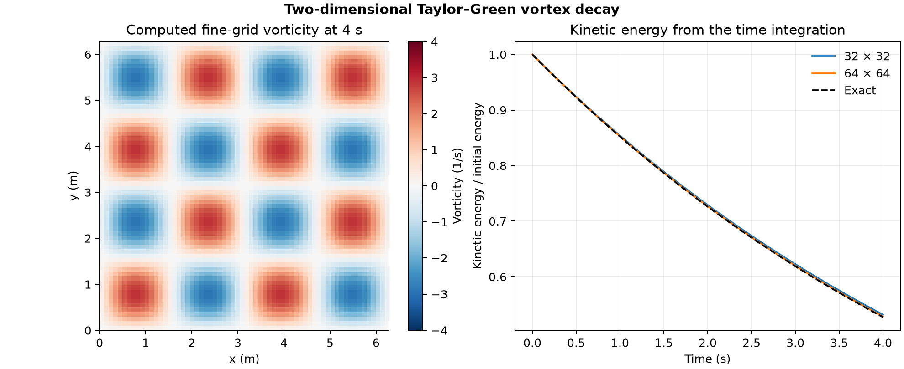

# 40. Decay of a two-dimensional Taylor–Green vortex

A doubly periodic array of counter-rotating vortices loses kinetic energy as viscosity smooths the velocity field. A Python finite-difference solver integrated the incompressible vorticity equation to 4 s. The computed energy on the finer grid was **52.84%** of its initial value, compared with **52.73%** in the exact solution.

| Quantity | 32 × 32 | 64 × 64 |
| --- | ---: | ---: |
| Time step (s) | 0.005 | 0.0025 |
| Actual steps | 800 | 1,600 |
| Maximum error in energy fraction | 0.00433 | 0.00108 |
| Maximum velocity RMS error (m/s) | 0.00911 | 0.00227 |

The square has side length 2π m, periodic boundaries, peak initial speed 1 m/s, wavenumber 2 m⁻¹ and kinematic viscosity 0.01 m²/s. The solver uses centered spatial differences, FFT inversion of the discrete Poisson equation for the streamfunction, and fourth-order Runge–Kutta time integration. It computes the velocity and nonlinear advection from the vorticity at every integration stage. The exact solution predicts a velocity amplitude proportional to exp(−2νk²t) and kinetic energy proportional to its square. [Exact solution and benchmark context](https://www.iist.ac.in/sites/default/files/2025-06/taylor_green.pdf)

The energy decreased at every saved time. The largest discrete velocity divergence was below 1.3 × 10⁻¹⁵ s⁻¹. Both runs passed the [declared checks](PROTOCOL.md). The test covers a smooth two-dimensional viscous decay with combined space and time refinement.

[PDF](data/vortex-decay.pdf) · [Energy and error history](data/decay.csv) · [Checks](data/checks.json) · [Solver](solve_taylor_green.py)

Run `python solve_taylor_green.py /path/to/new-output` with NumPy and Matplotlib to reproduce both calculations.
