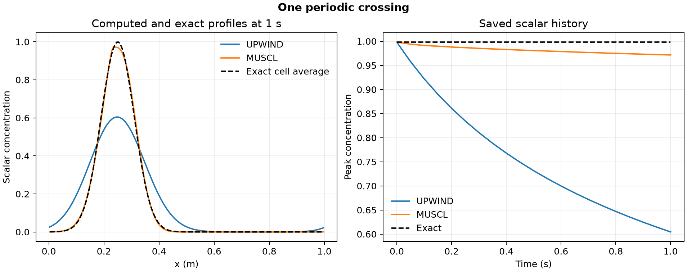

# 41. Numerical diffusion of a tracer pulse

A Gaussian tracer pulse travels once around a 1 m periodic domain at 1 m/s. With zero physical diffusivity, the analytical profile returns to its starting shape at 1 s. The two calculations preserve tracer mass to within 1.7 × 10⁻¹⁴ of its initial value, while their final shapes differ.

| Quantity at 1 s | First-order upwind | Limited MUSCL |
| --- | ---: | ---: |
| Peak concentration | 0.6045 | 0.9716 |
| Exact peak cell average | 0.9982 | 0.9982 |
| Integrated absolute error / initial mass | 47.70% | 2.39% |

The Python finite-volume solver uses 160 uniform cells, the same 460 SSPRK3 steps for both schemes, and conservative flux differences across periodic faces. The higher-resolution method reconstructs the face concentration with a monotonized central slope limiter. The zero-diffusivity comparison isolates numerical broadening in this test. [Upwind finite-volume background](https://faculty.washington.edu/rjl/ipde/slides/leveque3nup3.pdf)

[PDF](data/periodic-transport.pdf) · [All saved profiles](data/profiles.csv) · [History](data/history.csv) · [Checks](data/checks.json) · [Protocol](PROTOCOL.md) · [Solver](solve_transport.py)

The finite-volume model uses a prescribed velocity in one spatial dimension. Run `python solve_transport.py 41 /path/to/new-output` with NumPy and Matplotlib. The project owner directed the portfolio expansion. Codex implemented and ran the calculations, checked the evidence, and produced the figure.
