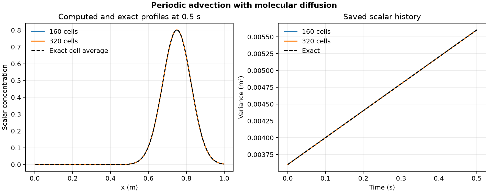

# 42. Physical spreading of an advected tracer

A Gaussian tracer moves through a 1 m periodic domain at 1 m/s with diffusivity 0.002 m²/s. The reference translates the pulse and increases its Gaussian variance by twice the diffusivity times elapsed time before summing periodic images. The numerical comparison uses reference cell averages.

| Quantity at 0.5 s | 160 cells | 320 cells |
| --- | ---: | ---: |
| Peak concentration | 0.79928 | 0.80142 |
| Exact peak cell average | 0.80085 | 0.80155 |
| Integrated absolute error / initial mass | 0.550% | 0.142% |
| Tracer variance around the advected centre (m²) | 0.00560358 | 0.00560083 |

The Python finite-volume solver uses limited MUSCL advection, centered diffusive face fluxes and SSPRK3. The step size is bounded by advection and diffusion, so space and time resolution change together. The 320-cell reference variance on the same grid is 0.00560081 m². Both runs maintained their mass within 4.1 × 10⁻¹⁴ of the initial mass across all steps.

[PDF](data/periodic-transport.pdf) · [All saved profiles](data/profiles.csv) · [History](data/history.csv) · [Checks](data/checks.json) · [Protocol](PROTOCOL.md) · [Solver](solve_transport.py)

The finite-volume model uses a prescribed velocity in one spatial dimension. Run `python solve_transport.py 42 /path/to/new-output` with NumPy and Matplotlib.
