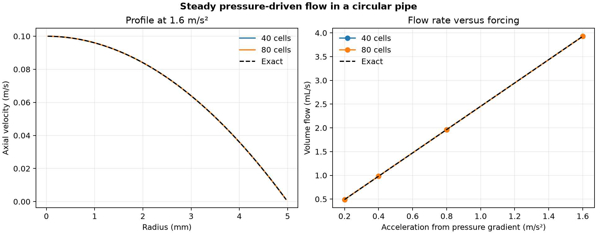

# 43. Steady pressure-driven flow in a circular pipe

A fully developed laminar flow in a 5 mm radius pipe responds linearly to the axial pressure gradient. At the largest forcing of 1.6 m/s², the fine calculation gave **3.92760 mL/s**, compared with **3.92699 mL/s** from Hagen–Poiseuille theory.

| Quantity | 40 radial cells | 80 radial cells |
| --- | ---: | ---: |
| Maximum relative flow-rate error | 0.06250% | 0.01562% |
| Maximum velocity RMS error / exact peak | 0.03125% | 0.00781% |

The Python finite-volume solver balances viscous momentum flux in annular cells at four applied accelerations. Acceleration is the axial pressure gradient divided by negative density. The axis has zero flux and the pipe wall is no-slip. Viscosity is 0.0001 m²/s. The analytical profile is parabolic and the reference flow is proportional to the forcing. The computed wall shear balances the prescribed forcing to roundoff on both grids. [Hagen–Poiseuille reference](https://open.oregonstate.education/intermediate-fluid-mechanics/chapter/introduction-to-viscous-flows/)

[PDF](data/pipe-flow.pdf) · [Radial profiles](data/profiles.csv) · [Flow results](data/flow.csv) · [Checks](data/checks.json) · [Protocol](PROTOCOL.md) · [Solver](solve_pipe.py)

This model assumes fully developed axisymmetric axial flow. Run `python solve_pipe.py 43 /path/to/new-output` with NumPy and Matplotlib. The project owner directed the expansion. Codex implemented, ran and checked the calculations and prepared the figure.
