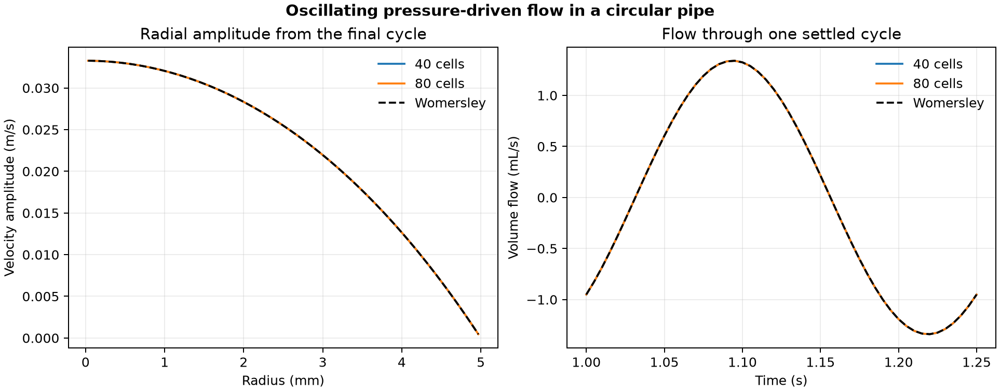

# 44. Pulsating pressure-driven pipe flow

A 4 Hz pressure forcing drives a resting fluid in a circular pipe. The flow lags the forcing because the fluid takes time to accelerate. The 80-cell calculation gave a final-period flow amplitude of **1.33964 mL/s** and a lag of about **45.21°** at Womersley number 2.507.

| Quantity | 40 radial cells | 80 radial cells |
| --- | ---: | ---: |
| Time step (ms) | 1.0 | 0.5 |
| Steps to 1.25 s | 1,250 | 2,500 |
| Relative flow-amplitude error | 0.0607% | 0.0152% |
| Absolute phase error (radians) | 0.0000813 | 0.0000204 |

The pipe radius is 5 mm, viscosity is 0.0001 m²/s and sinusoidal axial acceleration has amplitude 0.8 m/s². A Python finite-volume discretization of the radial momentum equation uses Crank–Nicolson with midpoint forcing. A sine and cosine fit uses 50 samples from the final period. The reference uses the analytical complex harmonic response with the no-slip wall, integrated over the annular cells. The comparison changes space and time resolution together. [Original Womersley formulation](https://pmc.ncbi.nlm.nih.gov/articles/PMC1365740/)

[PDF](data/pipe-flow.pdf) · [Radial profiles](data/profiles.csv) · [Flow results](data/flow.csv) · [Checks](data/checks.json) · [Protocol](PROTOCOL.md) · [Solver](solve_pipe.py)

This model assumes fully developed axisymmetric axial flow. Run `python solve_pipe.py 44 /path/to/new-output` with NumPy and Matplotlib. The project owner directed the expansion. Codex implemented, ran and checked the calculations and prepared the figure.
