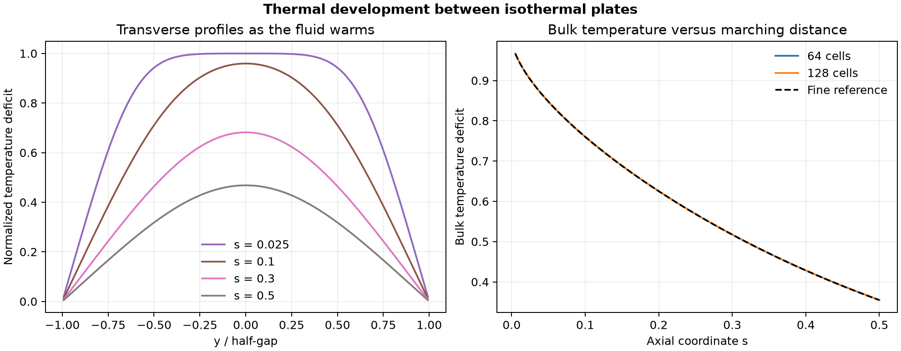

# 45. Thermal entrance region between heated plates

Cold fluid enters between isothermal hot plates with an already-developed parabolic velocity profile. The transverse temperature deficit falls as the fluid warms. The fine calculation reached an exit Nusselt number of **7.54076**, close to the developed value of 7.541 and to the 512-cell numerical reference of 7.54095. [Developed Nusselt reference](https://dspace.mit.edu/entities/publication/a003c1bc-e8d7-4bae-8529-66bcf3651bfe)

The Python finite-volume calculation marches the reduced Graetz equation along the channel. Axial conduction is omitted. The cross-stream coordinate uses the half-gap as its length scale and the axial coordinate is scaled by thermal diffusivity divided by mean speed times the squared half-gap. The temperature deficit is one at the cold inlet and zero at the hot walls. The reference advances cross-stream eigenmodes analytically in the axial direction on a finer transverse grid, with a separate 256-cell reference check.

| Check | 64 transverse cells | 128 transverse cells |
| --- | ---: | ---: |
| Maximum dimensionless bulk-temperature error | 0.000674 | 0.000359 |
| Maximum relative Nusselt error at s ≥ 0.025 | 0.895% | 0.444% |
| Exit Nusselt number | 7.54013 | 7.54076 |

[PDF](data/heat-transfer.pdf) · [Saved data](data/) · [Checks](data/checks.json) · [Protocol](PROTOCOL.md) · [Solver](solve_heat.py)

Run `python solve_heat.py 45 /path/to/new-output` with NumPy and Matplotlib. The project owner directed the expansion. Codex implemented and checked the calculations and produced the figure.
