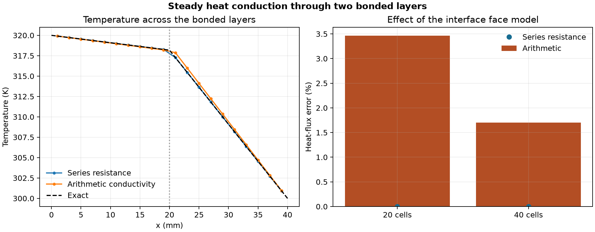

# 46. Heat conduction across a bonded interface

Two 20 mm layers conduct heat between fixed temperatures of 320 K and 300 K. Their conductivities are 10 and 1 W/(m·K), so the lower-conductivity layer carries most of the temperature drop. The exact series-resistance solution gives **909.09 W/m²** and an interface temperature of **318.182 K**.

The Python steady finite-volume solve compares two ways of assigning the interface conductance. The series-resistance form combines the two half-cell resistances. The arithmetic form averages the cell conductivities across the face. Both conserve the computed heat flux, but the arithmetic diagnostic overestimates it by 3.46% on 20 cells and 1.70% on 40 cells. The series-resistance solution matches the analytical heat flux and continuous interface temperature to roundoff for these aligned grids.

The model assumes perfect contact, steady one-dimensional conduction and constant material properties.

[PDF](data/heat-transfer.pdf) · [Saved data](data/) · [Checks](data/checks.json) · [Protocol](PROTOCOL.md) · [Solver](solve_heat.py)

Run `python solve_heat.py 46 /path/to/new-output` with NumPy and Matplotlib. The project owner directed the expansion. Codex implemented and checked the calculations and produced the figure.
