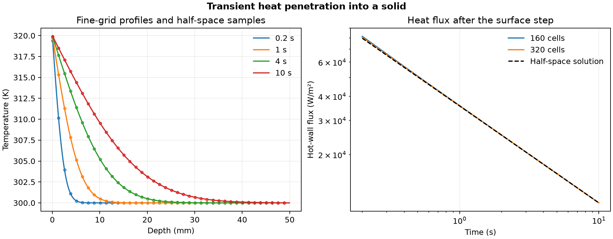

# 47. Transient heat penetration after a surface temperature step

The surface of an initially 300 K solid is stepped to 320 K. The warm region grows into the solid and the heat flux at the hot face falls. At 10 s the fine calculation gave a hot-wall flux of **11.286 kW/m²**. [Half-space solution](https://sites.ualberta.ca/~ccwj/Assets/Teaching/CHE314/7_Transient_conduction-Semi-infinite_solid/Handout/LaTeX/transient_conduction_semi-infinite_solid.pdf)

| Check | 160 cells | 320 cells |
| --- | ---: | ---: |
| Time step (s) | 0.01 | 0.005 |
| Maximum temperature error / 20 K step | 0.898% | 0.396% |
| Maximum relative hot-wall flux error | 2.267% | 1.030% |

The Python finite-volume solver uses backward Euler and a 50 mm slab with a cold face held at 300 K. Thermal diffusivity is 10⁻⁵ m²/s and conductivity is 10 W/(m·K). The half-space reference is compared over the saved interval from 0.2 to 10 s. At 10 s its predicted temperature rise at the cold face is about 0.041% of the imposed step, which bounds the size of the mismatch in the far boundary data.

The first 80-cell run missed the early temperature and flux limits. The accepted comparison uses finer meshes and smaller time steps with the same model, output times and limits.

[PDF](data/heat-transfer.pdf) · [Saved data](data/) · [Checks](data/checks.json) · [Protocol](PROTOCOL.md) · [Solver](solve_heat.py)

Run `python solve_heat.py 47 /path/to/new-output` with NumPy and Matplotlib.
