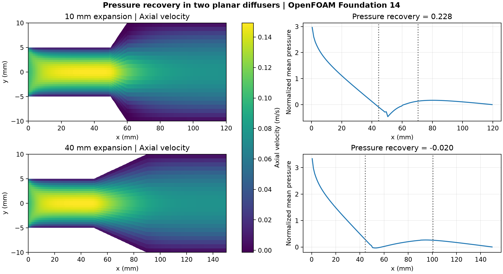

# Study 48 · Pressure recovery in two planar diffusers

Two symmetric diffusers have the same 2:1 height ratio and different expansion lengths. The comparison asks how taper length affects pressure recovery and reverse flow in laminar flow.

| Expansion length | Cells | Pressure recovery coefficient | Cells with axial velocity below −1 µm/s |
| --- | ---: | ---: | ---: |
| 10 mm | 2,880 | 0.2283 | 28 |
| 40 mm | 3,600 | −0.0204 | 0 |

The longer taper had no cells below the reverse-flow threshold, but its pressure at the downstream sample was slightly lower than at the upstream sample. The coefficient is the difference in section mean kinematic pressure divided by half the squared mean inlet speed. The dotted lines mark sections 5.5 mm before and 10.5 mm after each expansion. The longer taper adds wetted length within that measurement, so the coefficients include the associated wall friction.

## Method and checks

OpenFOAM Foundation 14 advanced each case to 800 steady SIMPLE iterations. Both used the same 10 mm inlet height, 20 mm outlet height, 50 mm straight inlet and 60 mm straight outlet, with 24 cells across and a 1 mm empty extrusion. The uniform inlet speed was 0.1 m/s and the kinematic viscosity was 2 × 10⁻⁵ m²/s. Walls were no-slip and the outlet used zero gauge kinematic pressure. Momentum convection used bounded upwind differencing.

Both meshes passed checkMesh. The largest final linear residual was 6.31 × 10⁻¹², the largest final local continuity report was 4.33 × 10⁻¹², and the relative inlet/outlet volume flux imbalance was below 2.3 × 10⁻¹³. The RMS velocity change over the last 50 iterations was below 3.0 × 10⁻¹⁴ m/s. These are two discrete solutions on one grid per geometry. The reverse-flow count and pressure recovery can depend on the grid, scheme and sampling locations.

## Files and reproduction

- [Protocol and limits](PROTOCOL.md), [numerical checks](data/checks.json), [pressure and velocity sections](data/pressure-sections.csv), [figure PDF](data/diffuser-comparison.pdf)
- [Native input files](case-inputs), [input hashes](case-inputs/input-sha256.json), [audit and plotting code](audit_diffuser_v003.py)

Copy the short and long case inputs into a writable runs directory. In each case run `blockMesh > mesh.log`, `checkMesh > check-mesh.log`, `foamPostProcess -func writeCellCentres -time 0 > centres.log`, and `foamRun > solver.log`. With NumPy and Matplotlib installed, run `python audit_diffuser_v003.py runs case-inputs/input-sha256.json new-output`. The analysis uses the saved cell centres to sort taper cells into streamwise bins. Earlier analysis drafts are kept locally; the calculation was not rerun for those revisions.

The portfolio owner authorized the study. Codex prepared the case inputs, audited the output and produced the figure. OpenFOAM computed the flow fields.
