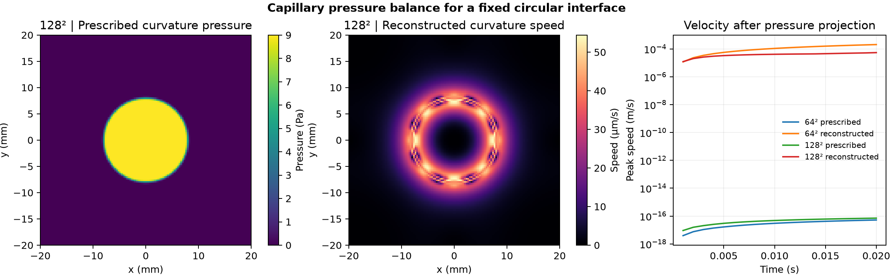

# Study 49 · Static capillary balance

A circular interface at rest provides a clean test of whether discrete surface tension and pressure balance. For a planar circle of radius 8 mm and surface tension 0.072 N/m, the pressure jump is 9 Pa.

| Curvature | Grid | Pressure jump (Pa) | Final peak speed (m/s) |
| --- | ---: | ---: | ---: |
| Prescribed | 64 × 64 | 9.0000 | 5.21 × 10⁻¹⁷ |
| Prescribed | 128 × 128 | 9.0000 | 7.07 × 10⁻¹⁷ |
| Reconstructed | 64 × 64 | 9.0373 | 2.06 × 10⁻⁴ |
| Reconstructed | 128 × 128 | 9.0092 | 5.44 × 10⁻⁵ |

Reconstructing curvature from the interface produced small numerical currents. On the finer grid the reconstructed pressure-jump error fell from 0.414% to 0.103%, and the final peak speed fell by 74%. The prescribed-curvature cases balanced to roundoff. The maximum reported discrete divergence was below 3.77 × 10⁻¹³ s⁻¹.

## Method and scope

A Python staggered-grid pressure projection separated the pressure gradient from the capillary forcing in a periodic 40 mm square. The simulations used 20 linear Stokes steps of 1 ms at uniform density 1,000 kg/m³ and kinematic viscosity 10⁻⁵ m²/s. The color function smoothed the interface over three cells. The circle stayed fixed and the calculation omitted inertial advection, so this tests numerical force balance for one interface and does not model droplet motion or breakup. For background on discrete force balance, see [François et al.](https://laro.lanl.gov/esploro/outputs/journalArticle/A-balanced-force-algorithm-for-continuous-and/9916364823103761).

Run `python solve_capillary.py new-output` with NumPy and Matplotlib installed.

- [Protocol and limits](PROTOCOL.md), [solver](solve_capillary.py), [numerical checks](data/checks.json)
- [Speed and divergence histories](data/speed-history.csv), [fine-grid centerline data](data/fine-centerline.csv), [figure PDF](data/capillary-balance.pdf)

The portfolio owner authorized the study. Codex implemented, ran and checked the Python calculation and prepared the figure.
