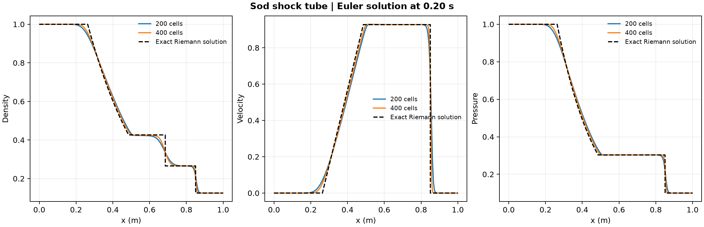

# Study 50 · Sod shock tube

The [Sod problem](https://www.sciencedirect.com/science/article/pii/0021999178900232) starts from two stationary gas states separated by a diaphragm. Once the diaphragm is removed, the Euler solution develops a left-moving rarefaction, a contact discontinuity and a right-moving shock.

| Cells | Density L1 error | Velocity L1 error | Pressure L1 error | Contact position (m) | Shock position (m) |
| ---: | ---: | ---: | ---: | ---: | ---: |
| 200 | 0.01200 | 0.01795 | 0.00959 | 0.6800 | 0.8550 |
| 400 | 0.00754 | 0.00982 | 0.00564 | 0.6825 | 0.8525 |
| Exact reference | — | — | — | 0.68549 | 0.85043 |

The finer grid reduced the endpoint density L1 error by 37%. The fine-grid mean left star pressure was 0.30306, compared with the exact value 0.30313. Density and pressure stayed positive, and the maximum discrete mass, momentum or energy discrepancy after accounting for boundary fluxes was 2.0 × 10⁻¹⁵ in the study's scaled variables.

## Method and scope

The calculation uses first-order finite volumes with HLL fluxes for a one-dimensional ideal gas with γ = 1.4. The diaphragm is at x = 0.5 m in a 1 m domain. The scaled initial states are (density, velocity, pressure) = (1, 0, 1) and (0.125, 0, 0.1). A CFL of 0.45 and zero-gradient boundary states are used up to 0.20 s, before any wave reaches an end. The exact solution is integrated in conserved variables over each cell, then converted to primitive variables for comparison. The reported positions are the strongest numerical gradients inside the declared windows around the contact and shock. The contact remains smeared by numerical diffusion. Two grids provide an error comparison for this idealized benchmark.

Run `python solve_sod.py new-output` with NumPy and Matplotlib installed.

- [Protocol and limits](PROTOCOL.md), [solver and exact reference code](solve_sod.py), [numerical checks](data/checks.json)
- [Endpoint profiles](data/profiles.csv), [saved error histories](data/errors.csv), [figure PDF](data/shock-tube.pdf)
