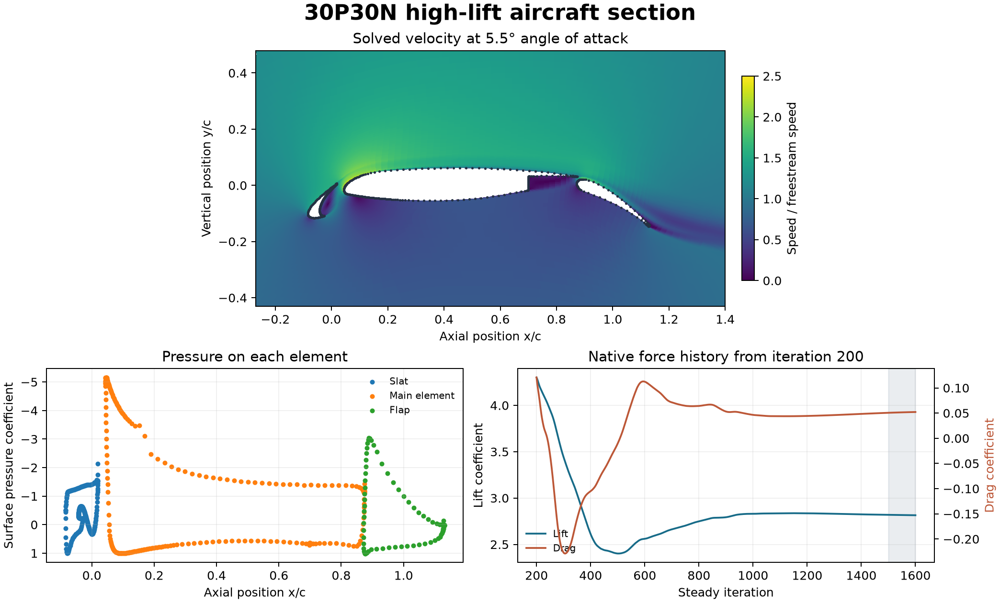

# 30P30N high-lift aircraft section

A leading-edge slat, main airfoil and deployed flap form a high-lift section representative of an aircraft approach configuration. This study uses the APC-IV 30P30N coarse grid distributed by the SU2 verification and validation collection. The 63,957 planar quadrilaterals are extruded by one cell over a 10 mm reference span, retaining the original two-dimensional geometry. The OpenFOAM Foundation 14 run uses incompressible Spalart–Allmaras RANS at 5.5° incidence, 58.59 m/s and a chord Reynolds number of 1.71 million.

The final 100 of 1,600 steady iterations give a mean lift coefficient of **2.816** and drag coefficient of **0.0514**. The slat, main element and flap contribute 0.159, 2.195 and 0.463 to lift coefficient, respectively, using the same reference area. The coefficient histories use force directions aligned with and normal to the incoming flow. The figure starts its histories at iteration 200 to show the approach to the final values. The CSV includes the full run.

The mesh, final residuals, farfield mass balance and final force ranges passed the declared checks. Pressure forces reconstructed from the mesh faces agree with the native reports for each element. OpenFOAM bounded its modified turbulent viscosity in 1,591 iterations, including the final iteration. The 143 m/s peak local speed also makes the incompressible assumption a limitation near the suction peak. The result is a checked numerical baseline on one coarse grid. Grid sensitivity, compressibility effects and agreement with wind-tunnel measurements remain open.

[PDF figure](figures/high-lift-section.pdf) · [Lift, drag and residual history](data/coefficients.csv) · [Surface pressures](data/surface-pressure.csv) · [Numerical checks](data/checks.json)

To reproduce the case, download the pinned compressed grid and pass its absolute path as the second argument to the run script after the absolute path for a new case directory. The generator checks the grid SHA-256 before use. The Python audit accepts the completed case directory, the shared field reader and a new output directory.

[Source grid](https://raw.githubusercontent.com/su2code/VandV/86a7f94ea29949f4d5e7f034d1d04ac3ef04a844/rans/30p30n/2D_L1_coarse_r1.su2.gz) · [Benchmark setup](https://su2code.github.io/vandv/30p30n/) · [Case generator](method/prepare-30p30n.py) · [Run script](method/run-30p30n.sh) · [Audit](method/audit-30p30n-v003.py) · [Shared field reader](../../lessons/48-planar-diffuser-recovery/audit_diffuser_v003.py)
