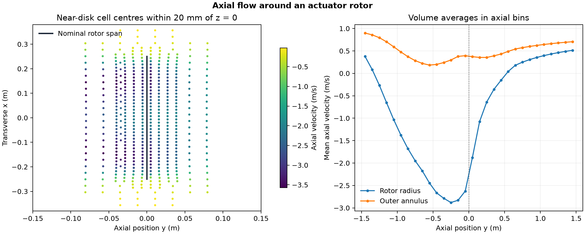

# Axial flow around an actuator rotor

How does a distributed rotor force change flow through the central region of an axial passage?

## Setup and checks

OpenFOAM Foundation 14 ran the [rotor disk tutorial](https://github.com/OpenFOAM/OpenFOAM-14/tree/master/tutorials/incompressibleFluid/rotorDisk). A three-blade rotor at 1,000 rpm applies a distributed momentum source in 1,148 cells of a 71,923-cell three-dimensional mesh. The inlet velocity is 1 m/s in the positive axial direction. The model uses a fixed trim, lookup profiles and k–ω SST turbulence closure.

The mesh passed its native checks. SIMPLE reached its specified residual limits at iteration 103. All three saved states passed field, clock and turbulence checks, with a terminal local continuity error of 1.22 × 10⁻⁵. The native force-density fields at iterations 50 and 100 have support only inside the rotor zone. Their volume integrals reproduced the solver's effective lift and power under its configured reference density.

## Result

Within 0.25 m of the axis, the average axial velocity was **−2.504 m/s** in the upstream sample and **−0.0495 m/s** in the downstream sample. Both signs refer to the positive inlet direction. The sampled core reverses near the disk, while the outer annulus in the profile continues in the inlet direction. The final solver report gives effective lift of 1,709 N and effective power of −3,980 W, equivalent to −38.0 N·m under the model's reporting convention and reference density of 1,000 kg/m³. These are model-source reports for the tutorial inputs. The single mesh and distributed force describe a steady modeled flow without resolving individual blade surfaces. [OpenFOAM rotor force calculation](https://github.com/OpenFOAM/OpenFOAM-14/blob/master/src/fvModels/rotorDisk/rotorDiskTemplates.C)

## Files

- [Saved iteration history](data/rotor-history.csv) and [axial profile](data/rotor-axial-profile.csv)
- [Numerical checks and native source hashes](data/checks.json)
- [Vector figure](data/actuator-rotor-disk.pdf)
- [Case runner](run.sh) and [analysis script](audit.py)

Run the shell script with an absolute path to a new case directory whose parent exists. Pass the case directory, the repository's [native field reader](../../lessons/48-planar-diffuser-recovery/audit_diffuser_v003.py) and a new output directory to the Python script. The analysis uses NumPy and Matplotlib.

[Return to the project index](../../docs/MODEL_INDEX.md)
