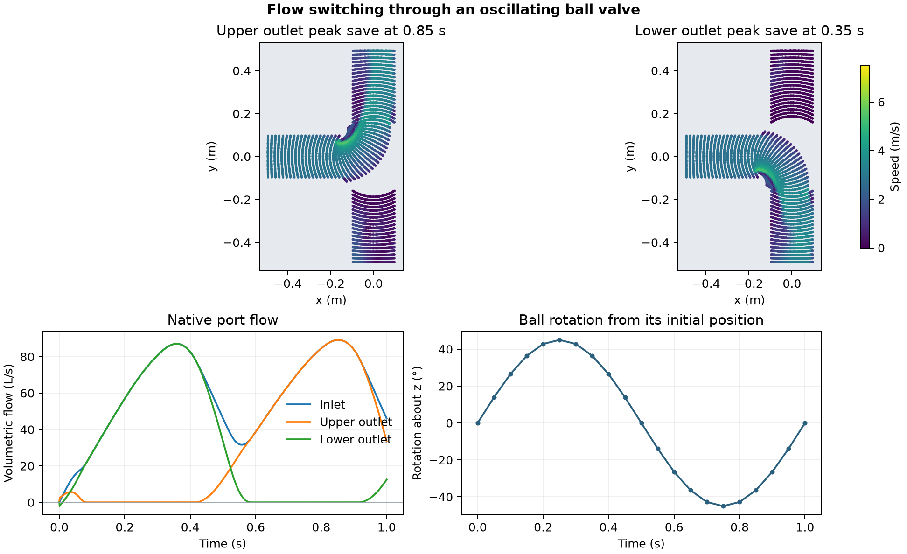

# Flow switching through an oscillating ball valve

A rotating passage connects a pressure-driven inlet to two outlets. The ball starts at −45° about z, then follows the prescribed oscillation of ±45° relative to that position at 1 Hz. A non-conformal interface joins the rotating and stationary mesh regions. [OpenFOAM Foundation 14 case](https://github.com/OpenFOAM/OpenFOAM-14/tree/master/tutorials/incompressibleFluid/ballValve)

The maps show native cell centres within 25 mm of the z = 0 plane on a common speed scale. Each map is from the saved time with the largest flow through the named outlet. The flow plot uses every native report. It shows inward flow as positive at the inlet and outward flow as positive at the outlets.

The lower outlet peaked at 86.86 L/s among the saved states, at 0.35 s. The upper outlet peaked at 89.17 L/s at 0.85 s. The 30,400-cell run completed 2,282 steps over one second. Across twenty saves, the largest signed flow imbalance was 5.46 × 10⁻⁷ of peak port flow. The rotating cell centres matched the prescribed pose within 1.15 × 10⁻¹² m.

The flow history describes one prescribed cycle starting from rest. The calculation does not establish a repeatable cycle, a measured valve coefficient or mechanical loads.

[Saved states](data/saved-valve-states.csv) · [Native port flow](data/native-port-flow.csv) · [Numerical checks](data/checks.json) · [Figure PDF](data/ball-valve.pdf) · [Run script](run.sh) · [Audit script](audit.py)
