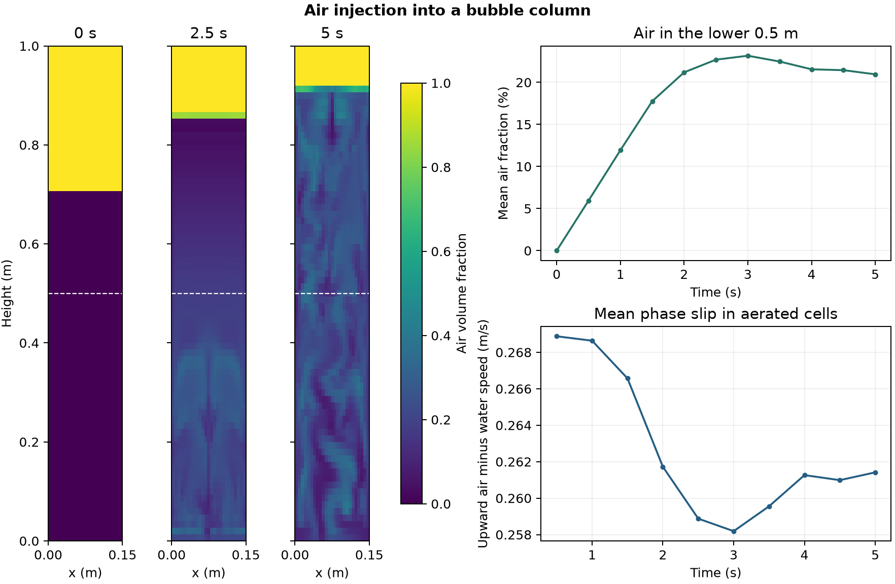

# Air injection into a bubble column

Air enters at the base of a 0.15 m wide column initially filled with water to about 0.7 m. The inlet prescribes an air volume fraction of 0.5 and an upward air velocity of 0.1 m/s. The Euler–Euler model evolves separate air and water velocities. The pressure-dependent air diameter law specifies 3 mm at 100 kPa. [OpenFOAM Foundation 14 case](https://github.com/OpenFOAM/OpenFOAM-14/tree/master/tutorials/multiphaseEuler/bubbleColumnLaminar)

The maps show the air volume fraction at the initial condition and at 2.5 and 5 s. The dashed line marks the 0.5 m upper boundary of the lower-column sample. The slip curve measures the vertical air velocity minus the vertical water velocity, averaged over cells in that sample with at least 1% air.

At 5 s, the mean air volume fraction in the lower sample was 20.96%. The mean upward slip was 0.261 m/s. The 1,875-cell calculation completed 1,000 steps. The ten saved states passed the phase-fraction, pressure and temperature checks. The maximum cellwise difference between the phase sum and one was 5.0 × 10⁻¹³.

The air fraction represents an averaged phase field. The observed distribution and slip depend on the inlet and interfacial closures. The simulated interval shows the development of aeration.

[Saved data](data/bubble-column-history.csv) · [Numerical checks](data/checks.json) · [Figure PDF](data/bubble-column.pdf) · [Run script](run.sh) · [Audit script](audit.py)
