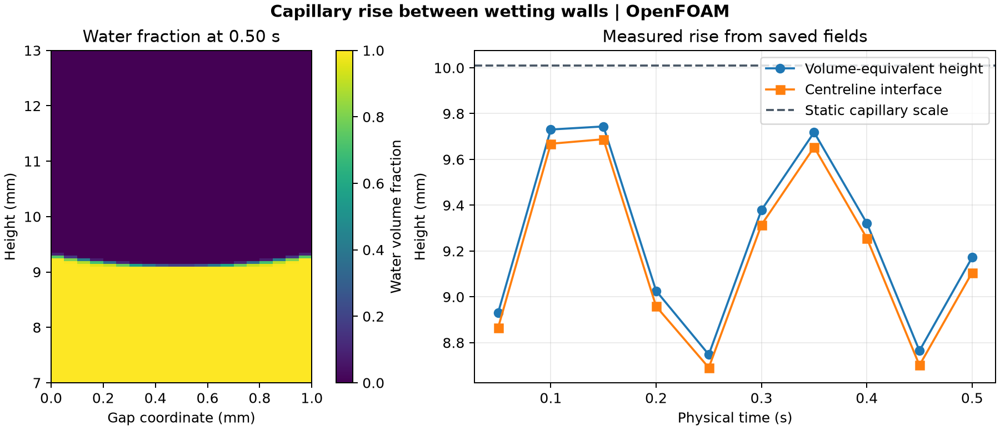

# Capillary rise between wetting walls

A wetting liquid climbs a narrow gap because the curved liquid–air interface creates a pressure difference. This case follows the motion in a 1 mm gap between parallel walls with a prescribed contact angle of 45°. The initial liquid height is 8 mm. The model uses a surface tension of 0.0707106 N/m, liquid and air densities of 1,000 and 1 kg/m³, and downward gravity of 10 m/s².

## Results

The volume-equivalent water height ranges from 8.75 to 9.74 mm across the saved states. At 0.50 s, the volume-equivalent height is **9.17 mm** and the centreline half-fraction crossing is **9.11 mm**. The latter is interpolated between adjacent cell centres along the mean of the two central columns. The volume-equivalent height is the integrated water volume divided by the horizontal cross-sectional area.

The dashed line is the ideal static parallel-plate scale, 2σ cos(θ) divided by the product of the density difference, gravitational acceleration, and gap width. It is **10.01 mm** for these inputs. The saved heights are still oscillating at 0.50 s. The ideal comparison assumes a static interface connected to a reservoir. The model uses prescribed reduced pressure at the top and bottom and permits exchange through the bottom opening.

## Numerical checks

OpenFOAM Foundation 14 advanced the case through 51,310 adaptive steps on a 20 × 400 mesh. The mesh passed the native check, and all ten saved states passed clock, field and phase-fraction checks. Intermediate solver reports included small water-fraction overshoots. The saved water fractions were within the declared tolerance of 10⁻⁶ around [0, 1]. The largest logged bulk and interface Courant numbers were 0.478, compared with the adaptive target of 0.2. This is a single-mesh transient calculation.

[Run script](run.sh) · [Audit script](audit.py) · [Numerical checks](data/checks.json) · [Height history](data/rise-history.csv) · [Figure PDF](data/capillary-rise.pdf)

The run script takes an absolute path to a new case directory. The audit takes the case directory, the [native field reader](../../lessons/48-planar-diffuser-recovery/audit_diffuser_v003.py), and a new result directory. The starting case comes from the [OpenFOAM Foundation tutorial](https://github.com/OpenFOAM/OpenFOAM-14/tree/master/tutorials/incompressibleVoF/capillaryRise).
