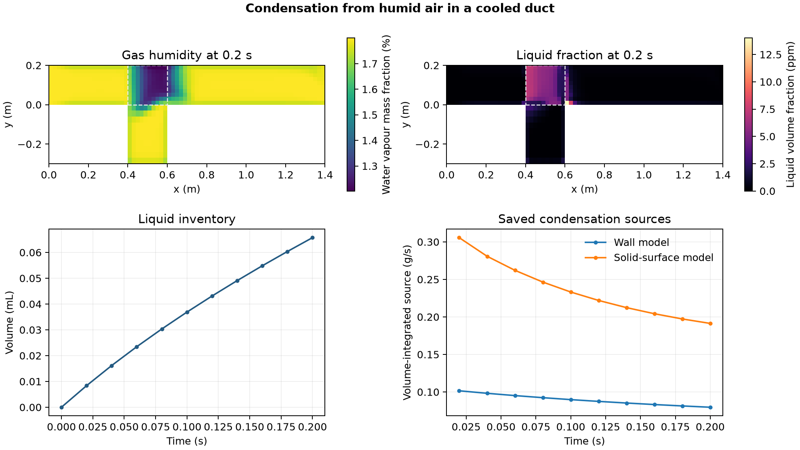

# Condensation from humid air in a cooled duct

The model tracks humid air, liquid water and a stationary solid phase in a duct with a lower sump. It uses the OpenFOAM Foundation 14 condenser tutorial mesh and both of its condensation models. The inlet supplies air at 0.5 m/s and 298.15 K with 1.8% water vapour by mass. The wall reference and initial solid temperature are 283.15 K. The dryer zone contains a prescribed 20% solid volume fraction. The domain begins with zero liquid water.

The serial run advanced through 71 time steps and saved ten fields up to 0.2 s. At the final save the duct held 0.0657 mL of liquid water. The gas-volume-weighted vapour mass fraction in the dryer zone reached 1.365%. The terminal volume-integrated wall and solid-surface condensation sources were 0.0796 and 0.1913 g/s, respectively. These rates describe two source terms active in the same calculation.

The 8,000-cell mesh passed the native mesh check. Saved phase and gas species fractions satisfied their bounds and cellwise sum checks. Absolute pressure and temperatures stayed positive, the stationary solid fraction remained fixed, and the final humidity and liquid inventory passed their declared checks. The run covers early liquid formation under the prescribed cooling conditions. Grid and time-step sensitivity, experimental validation, and a full transient water balance remain open.

[PDF figure](figures/condensing-vapour.pdf) · [Saved-state data](data/condensation-history.csv) · [Checks](data/checks.json) · [Run script](method/run-condensing-vapour.sh) · [Audit](method/audit-condensing-vapour.py) · [OpenFOAM Foundation tutorial](https://github.com/OpenFOAM/OpenFOAM-14/tree/master/tutorials/multiphaseEuler/condenser)
