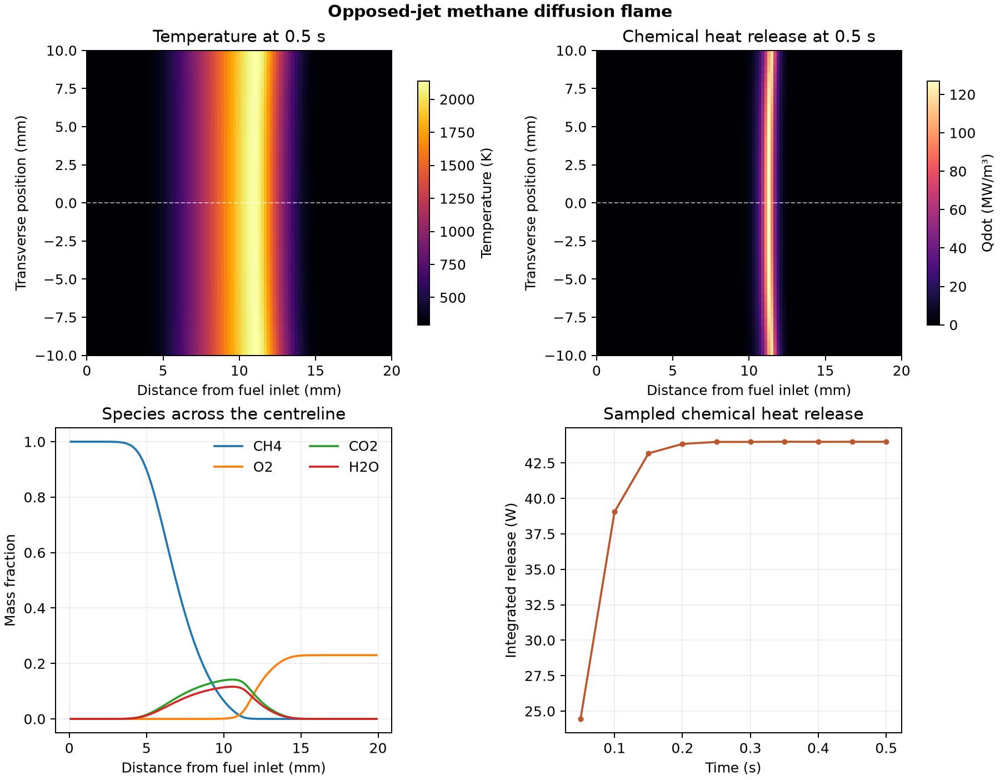

# Opposed-jet methane diffusion flame

Where does methane react when fuel and air enter from opposite sides?

## Model and checks

OpenFOAM Foundation 14 used the [counterflow flame tutorial](https://github.com/OpenFOAM/OpenFOAM-14/tree/master/tutorials/multicomponentFluid/counterFlowFlame2D). The 20 mm square section has 4,000 cells and a 20 mm empty extrusion depth. Methane and air enter at 293 K with opposing 0.1 m/s velocities. The model starts with a 2,000 K interior and uses laminar transport and a single irreversible methane oxidation reaction. The hot initial field supplies the conditions for reaction to develop. [OpenFOAM tutorial reaction mechanism](https://github.com/OpenFOAM/OpenFOAM-14/blob/master/tutorials/multicomponentFluid/counterFlowFlame2D/constant/reactions)

The solver completed 1,702 time steps through 0.5 s. All ten saved states passed temperature, pressure and species checks. The largest cellwise error in the sum of the five mass fractions was 1.73 × 10⁻¹⁰.

## Result

At 0.5 s, the hottest cell was **2,139 K**. Peak chemical heat release was **127 MW/m³** at **11.3 mm** from the fuel inlet. The reaction source integrated to **44.0 W** over the specified extrusion. Methane and oxygen fall on opposite sides of the reaction layer, where carbon dioxide and water vapour are produced. The centreline curves average the two adjacent native cell rows. The case-specific reaction mechanism and one mesh are adequate for showing the computed structure. The calculation does not establish experimental flame speed, emissions or extinction limits.

## Files

- [Saved heat release and species checks](data/flame-history.csv)
- [Centreline fields](data/flame-centreline.csv)
- [Numerical checks and native source hashes](data/checks.json)
- [Vector figure](data/counterflow-methane-flame.pdf)
- [Case runner](run.sh) and [analysis script](audit.py)

Run the shell script with an absolute path to a new case directory whose parent exists. Pass the case directory, the repository's [native field reader](../../lessons/48-planar-diffuser-recovery/audit_diffuser_v003.py) and a new output directory to the Python analysis script. The analysis uses NumPy and Matplotlib.

[Return to the project index](../../docs/MODEL_INDEX.md)
