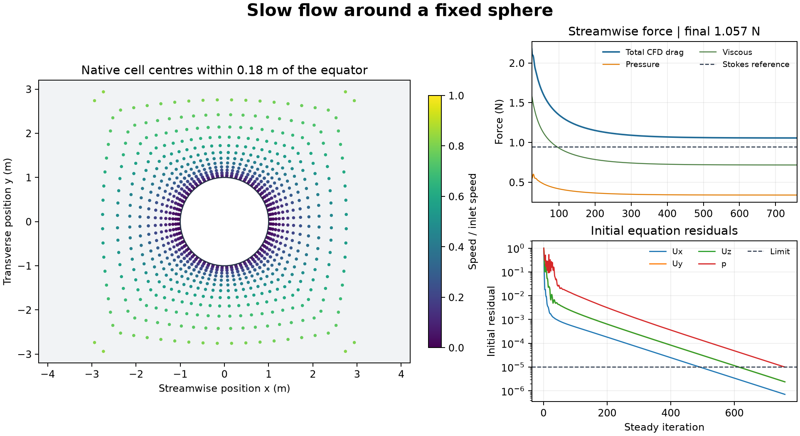

# Slow flow around a fixed sphere

A three-dimensional, steady OpenFOAM Foundation 14 calculation resolves incompressible laminar flow around a no-slip sphere of radius 1 m. The 36 m cubic domain uses a 0.05 m/s inlet, matching tangential velocity on the lateral faces, and zero gauge kinematic pressure at the outlet. The kinematic viscosity is 1 m²/s and the force reference density is 1 kg/m³. The Reynolds number based on diameter is 0.1.

The 36,864-cell hexahedral mesh passed its geometry and quality checks. The first mesh missed the declared sphere-radius tolerance. The final case projects the 1,538 sphere boundary vertices to radius 1 m while preserving all other points and the connectivity. The resulting case converged in 759 steady iterations and saved 31 computed fields. Each terminal initial residual was below 1e-5, the relative boundary volume imbalance was 1.37e-9, and the sphere and lateral patches had zero normal flux in the saved terminal field.

The native pressure and viscous contributions to streamwise force were 0.340 N and 0.718 N, giving a drag of 1.057 N. The analytical Stokes drag for an isolated sphere in the unbounded creeping-flow limit is 0.9425 N. The finite-domain calculation is 12.2% higher. The analytical comparison supplies a reference for scale and direction. The separate effects of domain size, mesh resolution and finite Reynolds number were not quantified.

To reproduce the run, pass an absolute path to a new case directory to the run script on a system with Foundation 14 installed at /opt/openfoam14. Keep the projection script in the same directory as the runner. The audit accepts the case directory, the shared OpenFOAM field reader and a new output directory in that order.

[PDF figure](figures/creeping-sphere.pdf) · [Force history](data/force-history.csv) · [Residual history](data/residual-history.csv) · [Checks](data/checks.json)

[Run script](method/run-creeping-sphere-v002.sh) · [Mesh projection](method/project-sphere-points.py) · [Audit](method/audit-creeping-sphere-v002.py) · [Shared field reader](../../lessons/48-planar-diffuser-recovery/audit_diffuser_v003.py) · [Stokes reference](https://pmc.ncbi.nlm.nih.gov/articles/PMC5690466/)
