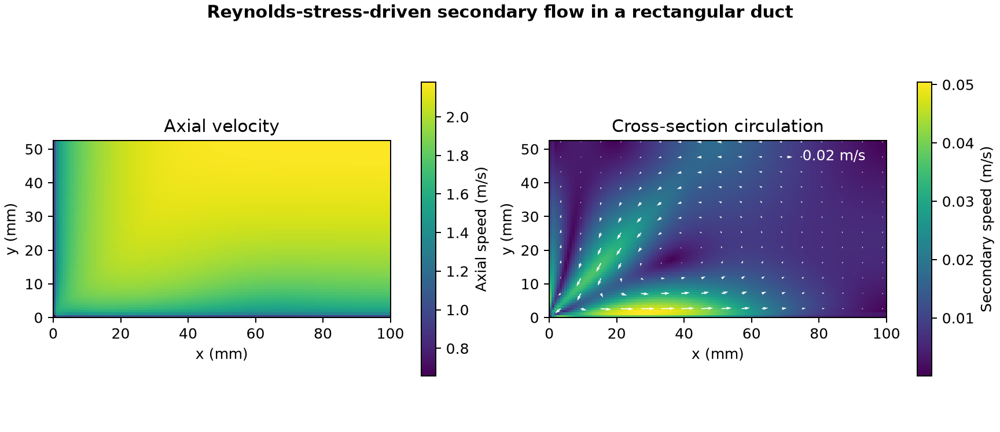

# Secondary flow in a rectangular duct

How much cross-section circulation does the Reynolds-stress model predict in a straight duct?

## Setup and checks

OpenFOAM Foundation 14 ran its [rectangular duct secondary-flow tutorial](https://github.com/OpenFOAM/OpenFOAM-14/tree/master/tutorials/incompressibleFluid/ductSecondaryFlow). The computed quarter cross-section is 100 by 52.5 mm. The lower and left edges are no-slip walls, while the upper and right edges are symmetry planes. The 1 mm streamwise layer is periodic and the mesh has 9,380 cells. The flow used the Launder–Reece–Rodi Reynolds-stress model, wall functions, kinematic viscosity of 10⁻⁶ m²/s and a mean axial velocity constraint of 1.95 m/s.

The native SIMPLE residual controls stopped the run at 5,205 iterations. All 21 saved states passed the clock and finite-field checks. The normal Reynolds stresses were nonnegative and dissipation was positive. The terminal reported local continuity error was 5.55 × 10⁻⁸. The volume-weighted RMS change in velocity from iteration 5,000 to 5,205 was 0.000185 m/s.

## Result

The final mean axial speed was **1.950 m/s**. The RMS cross-section speed was **0.0157 m/s**, about **0.80%** of the axial mean. The peak cross-section speed was **0.0504 m/s**. The arrows show the in-plane velocity in the computed quarter section. The pattern describes the prediction of this closure and wall treatment on a single, streamwise-invariant mesh. Iteration history shows numerical convergence, while model and mesh accuracy would require separate comparisons.

## Files

- [Saved iteration history](data/duct-history.csv)
- [Numerical checks and native source hashes](data/checks.json)
- [Vector figure](data/duct-secondary-flow.pdf)
- [Case runner](run.sh) and [analysis script](audit.py)

Run the shell script with an absolute path to a new case directory whose parent exists. Pass the case directory, the repository's [native field reader](../../lessons/48-planar-diffuser-recovery/audit_diffuser_v003.py) and a new output directory to the Python script. The analysis uses NumPy and Matplotlib.

[Return to the project index](../../docs/MODEL_INDEX.md)
