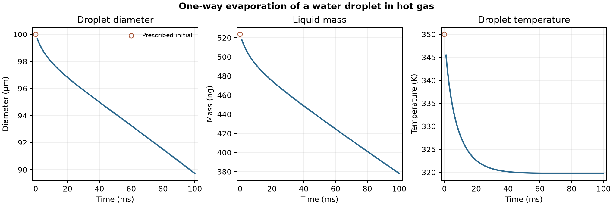

# One-way evaporation of a water droplet in hot gas

A water droplet starts at 100 μm diameter and 350 K in initially still gas at 473 K and 100 kPa. The gas initially contains 1% water vapour by mass. The model uses Ranz–Marshall heat transfer and the native liquid evaporation model. The droplet samples the gas fields through one-way coupling. [OpenFOAM Foundation 14 case](https://github.com/OpenFOAM/OpenFOAM-14/tree/master/tutorials/multicomponentFluid/parcelInBox)

At 100 ms, the droplet diameter was 89.72 μm and its temperature was 319.75 K. The native liquid mass fell from 523.60 to 378.15 ng. The reported 145.45 ng transferred by phase change accounts for the mass lost in the droplet model.

The carrier calculation completed 100 steps on 125 cells. One parcel remained present in all 100 saves. Its native diameter, density and multiplicity reproduced the reported liquid mass at every saved time. The carrier species checks passed. The initial markers are prescribed values.

The model reports the early cooling and evaporation of the droplet with no mass or heat feedback to the carrier. The 100 ms result does not give an experimental evaporation rate or a measured wet-bulb temperature.

[Saved parcel data](data/droplet-history.csv) · [Native cloud history](data/native-cloud-history.csv) · [Numerical checks](data/checks.json) · [Figure PDF](data/evaporating-droplet.pdf) · [Run script](run.sh) · [Audit script](audit.py)
