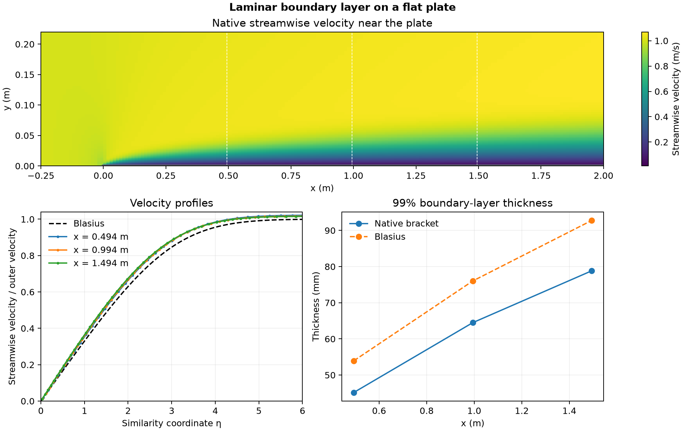

# Laminar boundary layer on a flat plate

Uniform flow enters at 1 m/s. A no-slip plate begins at x = 0 after a 0.25 m slip section. The upper boundary is 0.6 m above the plate. The model uses 17,280 cells and kinematic viscosity 2.5 × 10⁻⁴ m²/s. OpenFOAM converged in 640 steady iterations.

The three velocity profiles use the local mean streamwise velocity above y = 0.45 m as the outer velocity. The RMS difference from Blasius over similarity coordinates up to six ranged from 0.027 to 0.032. The native 99% thickness grew from 45.2 to 78.8 mm across the sampled stations. The Blasius values were 53.9 to 92.8 mm. [NASA laminar flat-plate reference](https://www.grc.nasa.gov/www/wind/valid/fplam/fplam.html)

The outer velocity increased from 1.022 to 1.046 m/s across the sample. The finite computational domain and its boundaries differ from the zero-pressure-gradient similarity assumptions. The relative inlet-to-outlet volume imbalance was 3.45 × 10⁻⁹.

[Profile data](data/plate-profiles.csv) · [Sampled stations](data/plate-stations.csv) · [Numerical checks](data/checks.json) · [Figure PDF](data/flat-plate-layer.pdf) · [Run script](run.sh) · [Audit script](audit.py)
