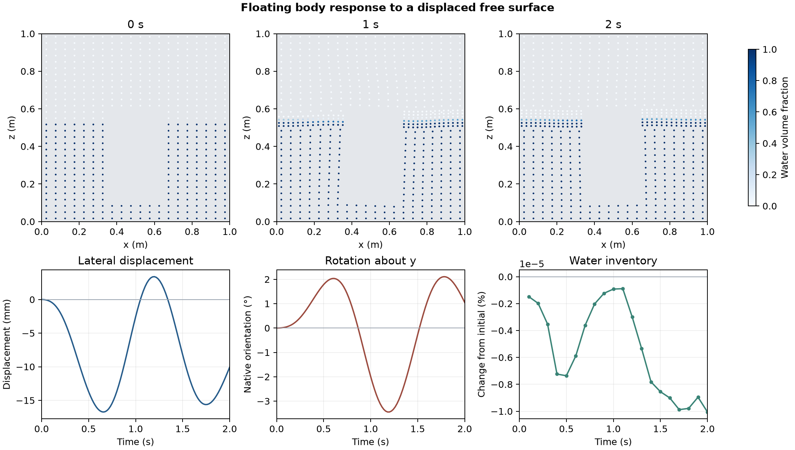

# Floating body response to a displaced free surface

A local bump in the water surface drives motion in a one metre tank. The 15 kg rectangular body is constrained to translate along y and rotate about y. The other degrees of freedom, including vertical translation, are fixed. This run uses the OpenFOAM Foundation 14 [floating body case](https://github.com/OpenFOAM/OpenFOAM-14/tree/master/tutorials/incompressibleVoF/floatingObject), with its moving and adaptive mesh.

The upper panels show cell centres in the slab 0.4 ≤ y < 0.5 m. The gap in the samples is the body. The lower panels show the displacement of the native rotation reference, its reported y orientation, and the water inventory at saved times. The water-surface bump starts outside the plotted slab.

Across 112 time steps to 2 s, the largest absolute lateral displacement was 16.73 mm and the largest absolute reported rotation was 3.45°. The mesh grew from 11,640 to 18,241 cells. All 20 saved fields passed the volume-fraction and volume checks; the largest relative water inventory change was 1.01 × 10⁻⁷. Motion and force reports were matched to the native step log.

The results describe this constrained motion over the simulated interval. They do not establish a free-floating response, mesh independence, or experimental validation.

[Saved states](data/saved-states.csv) · [Native motion and loads](data/motion-history.csv) · [Numerical checks](data/checks.json) · [Figure PDF](data/floating-body-response.pdf) · [Run script](run.sh) · [Audit script](audit.py)
