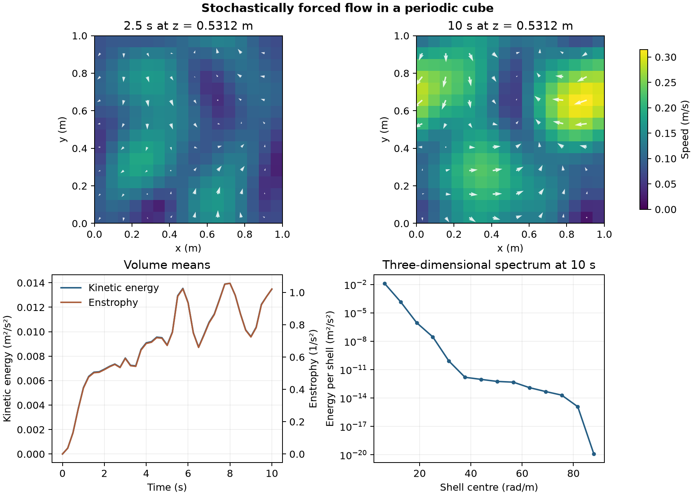

# Stochastically forced flow in a periodic cube

A 1 m cube starts from rest. An Ornstein–Uhlenbeck body force acts on a prescribed range of Fourier modes. The calculation uses a 16 × 16 × 16 grid, periodic faces, kinematic viscosity 0.025 m²/s and the laminar momentum formulation. [OpenFOAM Foundation 14 case](https://github.com/OpenFOAM/OpenFOAM-14/tree/master/tutorials/incompressibleFluid/boxTurb16)

The maps show cell-centre speed and in-plane velocity on the same scales at 2.5 and 10 s. The kinetic energy and enstrophy are volume means. The spectrum sums the squared three-dimensional Fourier coefficients by wavenumber shell. The plotted spectrum starts at the first nonzero shell. The data include the zero mode.

At 10 s, the mean kinetic energy was 0.01348 m²/s² and the mean enstrophy was 1.021 s⁻². The Fourier sum matched the direct kinetic energy to floating-point precision. The first run exceeded the prescribed mean-flow limit, reaching 2.08 × 10⁻⁶ m/s. Tightening the momentum solver tolerance from 10⁻⁵ to 10⁻⁸ reduced the maximum saved mean velocity norm to 7.05 × 10⁻⁹ m/s. The published run completed 400 steps and all 40 saved-state checks.

The spectrum describes the forced response on this coarse grid over the simulated interval. The study does not establish an inertial range, statistical stationarity or mesh convergence.

[Saved history](data/box-history.csv) · [Fourier spectrum](data/energy-spectrum.csv) · [Numerical checks](data/checks.json) · [Figure PDF](data/forced-periodic-box.pdf) · [Run script](run.sh) · [Audit script](audit.py)
