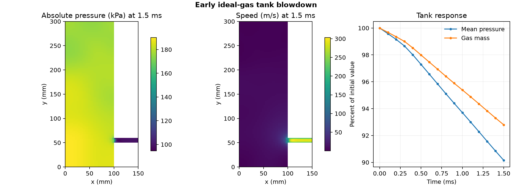

# Early ideal-gas tank blowdown

How do tank pressure, gas inventory and nozzle flow change just after the outlet opens?

## Setup and checks

OpenFOAM Foundation 14 used the 3,725-cell planar geometry and laminar settings from its [tank decompression tutorial](https://github.com/OpenFOAM/OpenFOAM-14/tree/master/tutorials/fluid/decompressionTank). The gas calculation replaces the tutorial's density polynomial with the perfect-gas properties of the [resonator tutorial](https://github.com/OpenFOAM/OpenFOAM-14/tree/master/tutorials/fluid/helmholtzResonance). The tank starts at 200 kPa absolute, 300 K and zero velocity. The nozzle is held at 100 kPa absolute. The planar model has a 20 mm extrusion depth and a 10 mm tall nozzle.

The mesh check passed. The calculation ran 3,000 steps of 0.5 μs and saved 15 states at 0.1 ms intervals. All saved interior velocity values were finite and all pressure and temperature values were positive. Native cell volumes and centres matched the plotted mesh polygons. Gas inventory was reconstructed from native pressure and temperature using the configured perfect-gas law. Saved density and reconstructed density agreed within 6.0 × 10⁻⁷ relative over all saved cells and times.

## Results

At 1.5 ms, volume-weighted pressure dropped from 200.0 to **180.3 kPa**, a **9.85%** reduction. Gas inventory fell from 1.414 to **1.312 g**, a **7.21%** reduction. The five nozzle-adjacent cells averaged **264 m/s** in the outward direction when weighted by face area. The five native nozzle-face fluxes summed to **0.0716 kg/s** outward at the final saved time. The zero flux listed at 0 s denotes the specified quiescent initial state. Later flux values are native saved face data.

This is a short, single-mesh planar calculation with a prescribed nozzle pressure. The sampled series describes the early response. It does not establish a continuous mass balance, physical choking or external jet development.

## Files

- [Sampled pressure, inventory and discharge](data/blowdown-history.csv)
- [Numerical checks and native source hashes](data/checks.json)
- [Vector figure](data/gas-tank-blowdown.pdf)
- [Case runner](run.sh) and [analysis script](audit.py)

Run the shell script with the absolute path to a new case directory whose parent exists. Pass the case directory, the repository's [native field reader](../../lessons/48-planar-diffuser-recovery/audit_diffuser_v003.py) and a new output directory to the Python analysis script. The script requires NumPy and Matplotlib.

[Return to the project index](../../docs/MODEL_INDEX.md)
