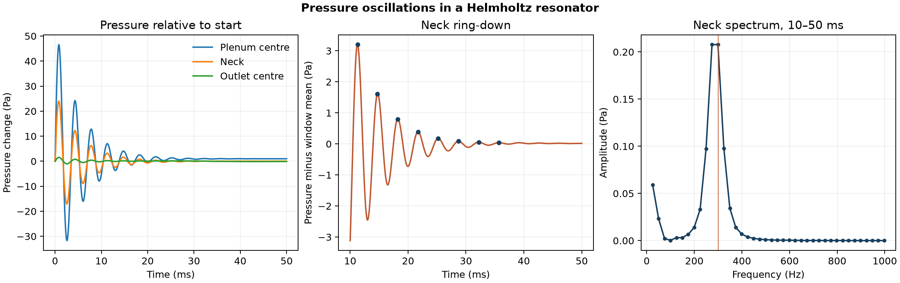

# Pressure oscillations in a Helmholtz resonator

How quickly does a pressure disturbance decay in a small plenum connected to a duct by a narrow neck?

## Model and checks

OpenFOAM Foundation 14 ran the resolved-plenum variant of its [Helmholtz resonator tutorial](https://github.com/OpenFOAM/OpenFOAM-14/tree/master/tutorials/fluid/helmholtzResonance). The 25,344-cell mesh retained the tutorial geometry, compressible perfect-gas model, pressure limiter and 0.1 g/s mass-flow inlet. The simulation advanced 500 steps of 0.1 ms through 50 ms. The mesh check passed and all five saved velocity, pressure and temperature fields passed the finite-value, positivity (pressure and temperature) and clock checks. All 501 samples from each of the five native pressure probes were checked against the declared positions and sample times.

## Measured response

From 10 to 50 ms, the neck pressure swung **6.315 Pa** peak to peak. Eight positive local peaks above the window mean had a median separation of **3.50 ms**, corresponding to about **286 Hz**. A Hann-windowed spectrum of the same mean-subtracted samples had its largest nonzero bin at **299 Hz**, with about **25 Hz** between bins. The native samples were already uniform. The nearby bins are similar in amplitude, so the exact bin centre carries little precision.

The classical lumped formula gives an approximate frequency of 364 Hz from the 20 mm straight neck length, 100 mm² throat area and 115.6 cm³ plenum volume. The latter includes the main plenum and outer annulus, excluding the rounded entrance. An illustrative length increment of 1.7 times the area-equivalent radius shifts the estimate to 300 Hz. This sensitivity depends on how the entrance and exit are represented. The case has mean through-flow and a numerical pressure limiter, and the comparison uses one mesh and a short decaying transient. The estimate and CFD trace do not establish experimental agreement or damping accuracy. [Selamet et al., Circular concentric Helmholtz resonators](https://mae.osu.edu/sites/default/files/2021-12/J18.pdf)

## Files

- [Pressure samples](data/probe-pressure.csv) and [neck spectrum](data/neck-spectrum.csv)
- [Numerical checks and native source hashes](data/checks.json)
- [Vector figure](data/helmholtz-resonance.pdf)
- [Case runner](run.sh) and [analysis script](audit.py)

Run the shell script with the absolute path to a new case directory whose parent exists. Pass that case, the repository's [native field reader](../../lessons/48-planar-diffuser-recovery/audit_diffuser_v003.py) and a new output directory to the Python analysis script. The script requires NumPy and Matplotlib.

[Return to the project index](../../docs/MODEL_INDEX.md)
