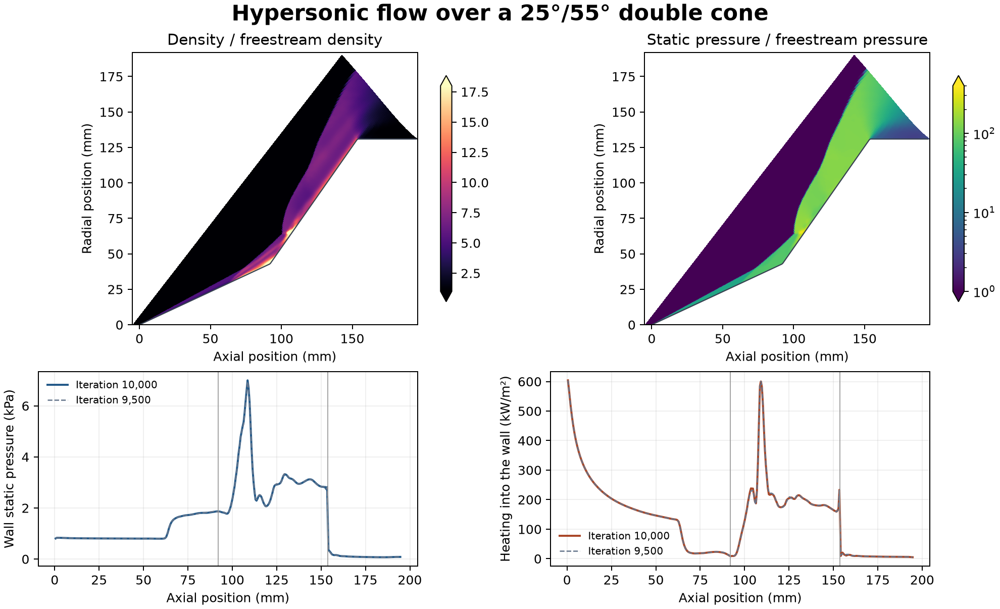

# Hypersonic flow over a 25°/55° double cone

A Mach 11.3 nitrogen stream passes over a sharp double cone at zero incidence. The first cone turns the flow through 25°, and the steeper 55° section produces a second shock that interacts with the first. The model uses the OpenFOAM Foundation 14 Run 35 tutorial with a 32,385-cell axisymmetric wedge. The prescribed freestream is 2,713 m/s, 22.74 Pa and 138.9 K. The wall temperature is 296.1 K, with velocity slip and temperature jump at the wall.

The calculation advances the tutorial’s supplied developed solution through 10,000 local-time-stepping iterations. It saves 20 new computed states. Iteration labels track numerical progress towards a steady solution. The final wall pressure peaks at 7.00 kPa at 108.6 mm from the tip. The original Run 35 paper reports a pressure spike of approximately 7 kPa near 110 mm. The numerical continuation is compared here with that reported feature. The peak heating into the wall is 604 kW/m² at the first cone face. A second heating peak appears downstream of the change in cone angle.

The imported mesh had two upstream axis vertices outside the common wedge axis. The final case corrects those two vertices and restores the nominal wedge planes before solving. The corrected mesh passed the native geometry check and kept the same cell connectivity and starting fields. The audit matches the saved wall heat flux to the native face-integral report and uses the zero-gradient pressure condition to recover wall pressure from the adjacent cells. The final two wall pressure and heating profiles differed by 0.69% and 0.99% in area-weighted relative RMS, respectively. The final net boundary mass flux mismatch was 0.47% of the incoming flow. The solver used its fixed iteration budget. A residual-based steady-convergence claim and a new experimental validation are outside this study.

Run the shell script with an absolute path to a new case directory. It uses the installed Foundation 14 tutorial, so its starting fields and grid remain with that installation. Keep the mesh correction script beside the runner. The Python audit takes the completed case, shared OpenFOAM field reader and a new output directory.

[PDF figure](figures/double-cone.pdf) · [Wall profiles](data/wall-profiles.csv) · [Local step and residual history](data/local-step-history.csv) · [Numerical checks](data/checks.json)

[Run script](method/run-hypersonic-double-cone-v003.sh) · [Mesh correction](method/project-cone-wedge-v002.py) · [Audit](method/audit-hypersonic-double-cone-v005.py) · [Shared field reader](../../lessons/48-planar-diffuser-recovery/audit_diffuser_v003.py) · [OpenFOAM Foundation tutorial](https://github.com/OpenFOAM/OpenFOAM-14/tree/master/tutorials/shockFluid/biconic25-55Run35) · [Run 35 reference paper](https://doi.org/10.1002/fld.2069)
