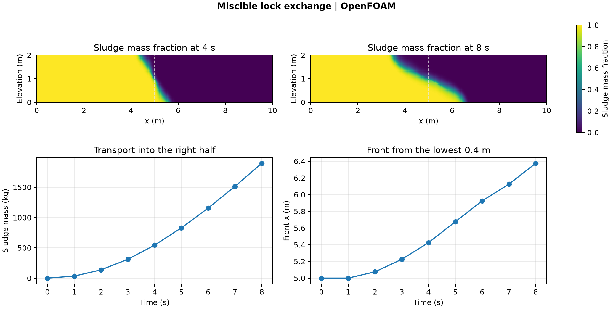

# Miscible lock exchange

A sealed rectangular tank starts with denser sludge on the left and lighter water on the right. The liquids move in opposite directions under gravity. The dense mixture advances along the floor while the lighter mixture moves left near the top. The OpenFOAM Foundation 14 multicomponent fluid solver treats them as miscible species in a single fluid mixture.

## Results

At 8 s, **1,895 kg of sludge**, or **9.48%** of the initial sludge mass, is in the right half of the tank. The lower-band front reaches **x = 6.375 m**, an advance of 1.375 m from the initial interface at x = 5 m. The front is the last contiguous column to the right of the initial interface whose mean sludge mass fraction in the lowest 0.4 m exceeds 0.5. The dashed line marks the initial interface.

The tank is 10 m long, 2 m high and extruded 2 m in the empty direction. The model uses laminar transport, pure-component densities of 1,000 kg/m³ for sludge and 990 kg/m³ for water, and gravity of 9.81 m/s².

## Numerical checks

The 8,000-cell mesh passed the native mesh check. The simulation reached 8 s in 94 steps, with eight checked saved states. The largest relative sludge mass discrepancy was 0.00536% of the initial 20,000 kg. Native density was checked against the volume-additive mixture density computed from the saved species fractions. The largest mass-fraction sum error at the endpoint was 5.0 × 10⁻⁷.

A run using the tutorial's backward time scheme and van Leer sludge advection exceeded the declared species bounds. The published case uses Euler time integration and upwind sludge advection. Those first-order schemes add numerical diffusion. The measured front applies to this mesh and short transient.

[Run script](run.sh) · [Audit script](audit.py) · [Numerical checks](data/checks.json) · [Transport history](data/lock-exchange-history.csv) · [Figure PDF](data/lock-exchange.pdf)

The run script takes an absolute path to a new case directory. It adjusts the schemes and endpoint of the [OpenFOAM Foundation tutorial](https://github.com/OpenFOAM/OpenFOAM-14/tree/master/tutorials/multicomponentFluid/lockExchange). The audit takes the case directory, the [native field reader](../../lessons/48-planar-diffuser-recovery/audit_diffuser_v003.py), and a new result directory.
