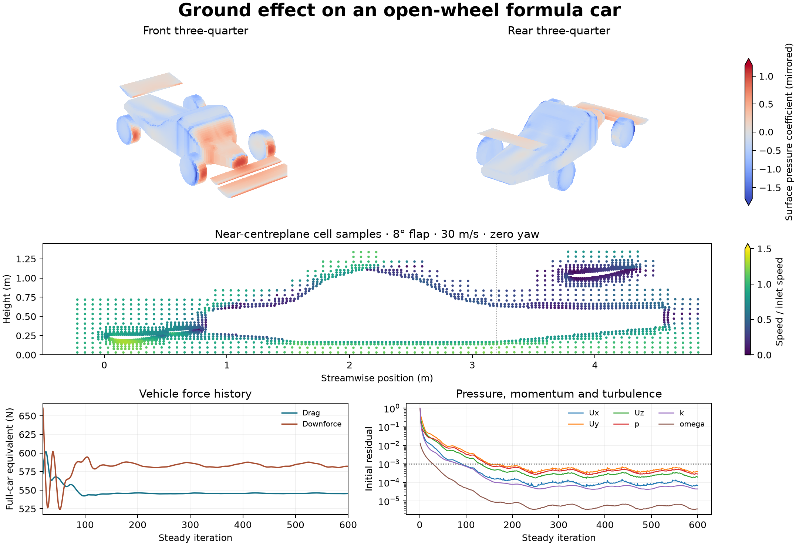
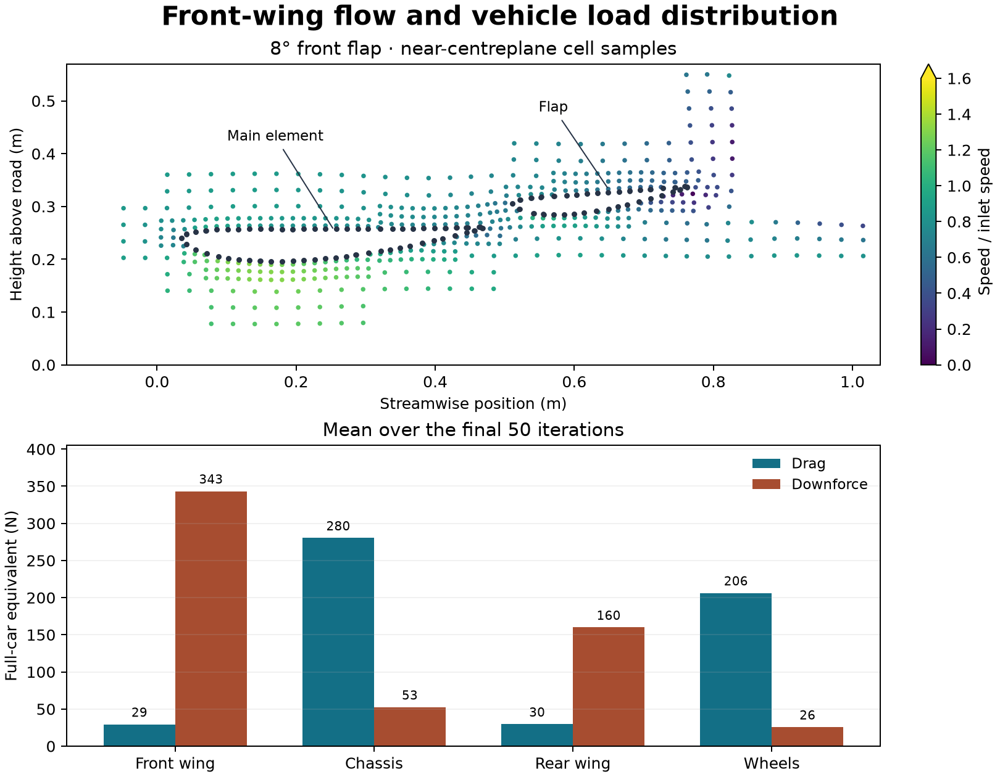

# Ground effect on an open-wheel formula car

[Front-flap comparison at 8°, 12° and 18°](flap-angle-comparison/README.md)

This three-dimensional OpenFOAM study resolves the airflow around an original F1-style geometry at 30 m/s. The 4.55 m car has a two-element front wing with an 8° flap setting, a raised nose, sidepods, a cockpit fairing, a single rear wing, an 8° diffuser, and four exposed wheels. A moving road and rotating wheel walls reproduce the relative motion in the vehicle frame.

| Component | Drag | Downforce |
| --- | ---: | ---: |
| Whole car | 545.46 N | 581.46 N |
| Front wing | 29.36 N | 343.32 N |
| Chassis | 280.31 N | 52.50 N |
| Rear wing | 29.58 N | 159.91 N |
| Wheels | 206.22 N | 25.73 N |

The front wing accounts for 59% of the modeled downforce. The pressure coefficient averaged −0.308 over the sampled flat underfloor ahead of the diffuser and −0.224 over the sampled rear ramp. Forces are full-car equivalents averaged over the final 50 of 600 steady iterations. Combined wheel loads come from the vehicle force report after subtracting the chassis and wing reports. Coefficients use a 1 m² reference area, 1.225 kg/m³ density and 30 m/s inlet speed.

## Setup and numerical checks

- OpenFOAM Foundation 14, steady incompressible SST RANS and kinematic viscosity of 1.5 × 10⁻⁵ m²/s. Inlet and road speeds are both 30 m/s. The 0.32 m radius wheels use imposed rotation at 93.75 rad/s and have 60 mm of geometric road clearance.
- The 95,109-cell half-domain has a centre-plane symmetry boundary at zero yaw. The pressure views mirror the computed half. Full-car drag and downforce are twice the corresponding half-domain forces. The speed plots show native cell-centre samples.
- The audit checked all 600 native residual rows and all 12 saved states. The maximum terminal initial residual was 3.73 × 10⁻⁴ against a 10⁻³ limit. Relative boundary flux imbalance was 8.16 × 10⁻⁸ against a 10⁻⁴ limit. Native wall motion, impermeable face flux, final-50 force stability and pressure-force readback all passed. The pressure-force readback integrates the pressure over mesh faces and checks it against the native solver report.

## Scope

Full-domain runs and the symmetric 12° and 18° settings missed the prescribed convergence threshold. The 12° setting also missed final-50 force stability. The report presents one accepted flap setting, so flap-angle effects, yaw and asymmetric wakes remain open. The geometry uses simplified fairings and omits suspension and wing supports. Mesh sensitivity, wall modelling and experimental validation remain open. Published two-element wing experiments motivate the front-wing ground-effect question. [Experimental front-wing reference](https://eprints.soton.ac.uk/22605/)

## Data and reproduction

[Vehicle figure PDF](figures/formula-car-flow.pdf) · [Front-wing detail PDF](figures/front-wing-detail.pdf) · [Force history](data/forces.csv) · [Component loads](data/component-loads.csv) · [Initial residuals](data/initial-residuals.csv) · [Numerical checks](data/checks.json)

Run the shell script with a fresh absolute case path and angle `8`. It uses Foundation 14, Python 3 and the installed `motorBikeSteady` spatial and pressure–velocity dictionaries. The Python figure exporter takes the closed case path, the shared field reader, and a new output directory. It runs the native audit before rendering.

[Case generator](method/prepare-formula-car-symmetric.py) · [Run script](method/run-formula-car-symmetric.sh) · [Native audit](method/audit-formula-car-symmetric-v002.py) · [Figure exporter](method/export-formula-car-single-v002.py) · [Shared field reader](../../lessons/48-planar-diffuser-recovery/audit_diffuser_v003.py)
