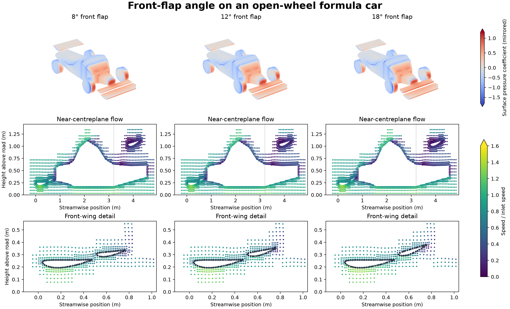
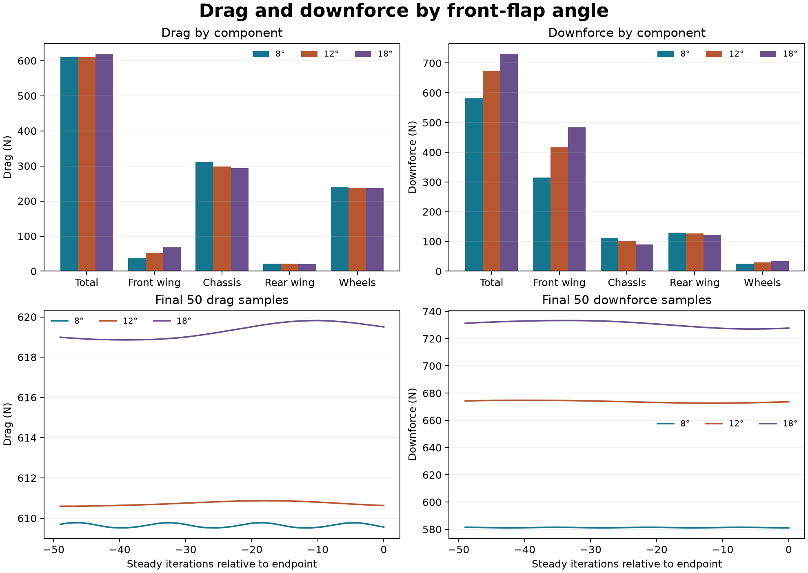

# Front-flap angle on an open-wheel formula car

Three steady OpenFOAM cases compare 8°, 12° and 18° front-flap settings on the same original F1-style car. The flap rotates around its leading edge. Source input hashes confirm that only the front flap surface differs before meshing. Each native mesh uses the same refinement and quality controls. The inlet and moving road are both 30 m/s. The four wheel walls rotate at 93.75 rad/s.

| Front flap | Half-domain cells | Total drag | Total downforce | Front-wing downforce | Largest initial residual in final 50 |
| --- | ---: | ---: | ---: | ---: | ---: |
| 8° | 95,109 | 609.65 N | 581.24 N | 314.36 N | 3.62e-04 |
| 12° | 95,145 | 610.73 N | 673.72 N | 416.32 N | 1.69e-04 |
| 18° | 95,084 | 619.30 N | 730.71 N | 484.31 N | 4.19e-04 |

| Front flap | Drag change from 8° | Downforce change from 8° |
| --- | ---: | ---: |
| 12° | +1.09 N | +92.48 N |
| 18° | +9.65 N | +149.47 N |

Loads are full-car equivalents averaged over iterations 1151 through 1200. Front-wing load includes the main element and flap. The report doubles the streamwise and vertical half-domain forces to obtain full-car equivalents. The zero-yaw symmetry assumption gives equal and opposite side forces. Pressure views mirror the computed half. Velocity views use actual cell-centre samples and fixed scales.

## Solver method and checks

The published baseline used `bounded Gauss linearUpwindV grad(U)` for momentum convection. The original 12° and 18° runs missed the residual limit. A 12° localEuler restart and subsequent return to the original steady equations also missed. The checked comparison restarts each original 600-iteration checkpoint with a common steady scheme. Its `fixedBlended` interpolation uses 25% of the original linear-upwind scheme and 75% first-order upwind. All other discretization and coupling controls, meshes, SST turbulence, geometry, boundary conditions and force references remain as in the original cases. [OpenFOAM fixed-blending source](https://github.com/OpenFOAM/OpenFOAM-14/blob/master/src/finiteVolume/interpolation/surfaceInterpolation/schemes/fixedBlended/fixedBlended.H)

Each 600-iteration continuation reached its fixed endpoint and passed native mesh, field, wheel-motion, pressure-force readback and final-50 force stability checks. Every one of the six reported initial residuals stayed at or below 10⁻³ over the final 50 iterations. The largest terminal relative boundary flux imbalance was 9.99e-07 against a 10⁻⁴ limit. The native audits retain both restart reports and remove the duplicate force row when joining histories.

At 8°, using the blend changed drag by +64.18 N and downforce by -0.22 N compared with the original accepted 8° result. The 8° drag shift exceeds the drag spread across all three angles under the blended scheme. Treat the small drag differences as specific to this discretization. The influence of this scheme at the higher angles, mesh sensitivity, wall modelling, and experimental validation remain open. The centre-plane constraint limits the model to symmetric head-on flow.

## Data and reproduction

[Force histories](data/forces.csv) · [Component loads](data/component-loads.csv) · [Residual histories](data/initial-residuals.csv) · [Numerical checks and input hashes](data/checks.json) · [Flow PDF](figures/flap-angle-flow.pdf) · [Load PDF](figures/flap-angle-loads.pdf)

The [case generator](method/prepare-formula-car-symmetric-v002.py) and [original runner](method/run-formula-car-symmetric-v002.sh) generate the three original cases with OpenFOAM Foundation 14. Use separate, fresh absolute case paths. The [restart runner](method/run-flap-restart-v002.sh) takes `blended`, the original case path twice, a fresh absolute continuation path, and the JSON from auditing the original case. The [audit](method/audit-flap-recovery-v002.py) exposes `audit(case, reader, iteration_cap, stages=())`. The [comparison exporter](method/export-flap-recovery-v002.py) takes the native case root, [shared field reader](../../../lessons/48-planar-diffuser-recovery/audit_diffuser_v003.py), a new output path and `--blended`. Use the original and continuation directory names recorded in the numerical checks. [Restart preparation](method/prepare-flap-restart-v002.py)
