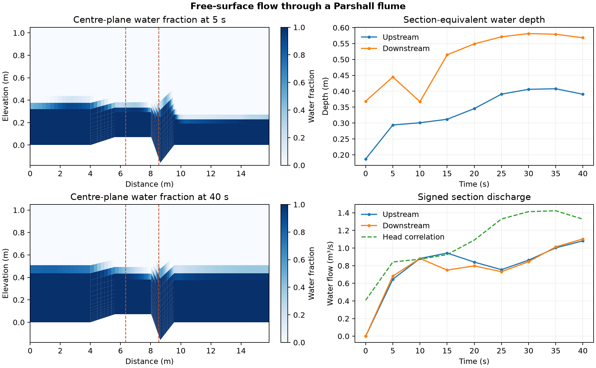

# Free-surface flow through a Parshall flume

How do water depth and discharge change as flow develops through a metering constriction?

## Model and checks

OpenFOAM Foundation 14 used the [Parshall flume tutorial](https://github.com/OpenFOAM/OpenFOAM-14/tree/master/tutorials/incompressibleVoF/parshallFlume) geometry and its 33,950-cell three-dimensional mesh. The model used water and air with a volume-of-fluid interface, a 1.0 m³/s specified inlet, a 0.25 m initial free-surface elevation and a k–ε turbulence closure. The calculation ran for 40 s with eight saved states at 5 s intervals. The centre-plane images use the average of the two native cell values beside each mesh face at the plane.

An initial run missed the saved water-fraction ceiling. A tighter final pressure solve reduced the terminal sum of absolute cell flux imbalances by more than three orders of magnitude, but five saves still missed the ceiling. The accepted run retained that pressure tolerance, used explicit MULES phase transport and set adaptive bulk and interface Courant targets to 0.45. The largest logged bulk value was 1.29 at startup, immediately before the controller shortened the step. The largest logged interface value was 0.4503. The accepted run completed 2,839 steps. All eight states passed the declared phase bound of [−10⁻⁶, 1 + 10⁻⁶], with a largest saved fraction of 1.0000002. The audit also checked mesh and save clocks, finite velocity and reduced pressure, and all four section discharges against signed native face fluxes. [OpenFOAM 14 phase transport source](https://github.com/OpenFOAM/OpenFOAM-14/blob/master/applications/modules/twoPhaseSolver/alphaPredictor.C)

## Measured response

| At 40 s | Upstream plane | Downstream plane |
| --- | --- | --- |
| Section-equivalent depth | 0.391 m | 0.568 m |
| Water discharge | 1.081 m³/s | 1.103 m³/s |
| Section Froude number | 0.465 | 0.343 |

The planes lie at streamwise positions 6.340 m and 8.540 m. The tutorial's built-in upstream-depth correlation returned 1.328 m³/s at the same save. The 40 s histories show a developing free surface and provide a comparison with that formula under the simulated conditions. They do not establish a steady rating curve, calibrated meter accuracy or grid independence.

## Files

- [Section histories and phase limits](data/flume-history.csv)
- [Numerical checks and native source hashes](data/checks.json)
- [Vector figure](data/parshall-flume.pdf)
- [Case runner](run.sh) and [analysis script](audit.py)

Run the shell script with the absolute path to a new case directory whose parent exists. Pass the case directory, the repository's [native field reader](../../lessons/48-planar-diffuser-recovery/audit_diffuser_v003.py) and a new output directory to the Python analysis script. The script requires NumPy and Matplotlib.

[Return to the project index](../../docs/MODEL_INDEX.md)
