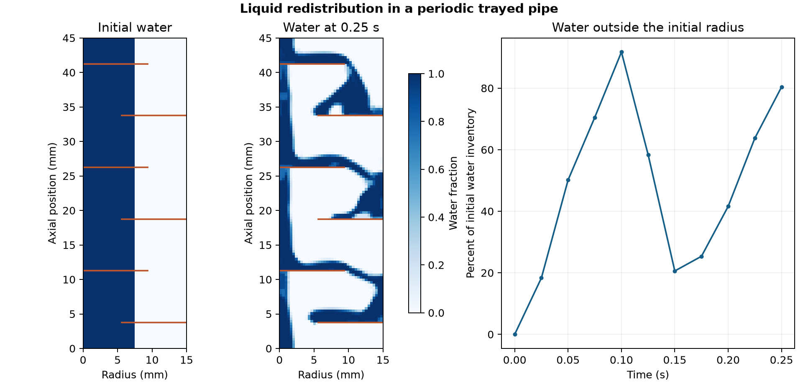

# Liquid redistribution in a periodic trayed pipe

How does a central water column spread around alternating internal baffles as it falls?

## Model and checks

OpenFOAM Foundation 14 used the [trayed pipe tutorial](https://github.com/OpenFOAM/OpenFOAM-14/tree/master/tutorials/incompressibleVoF/trayedPipe). The pipe has a 15 mm radius, a 45 mm axial period and six alternating baffles. The axisymmetric wedge contains 4,800 cells. It starts with still water inside a 7.5 mm radius and air outside. The calculation uses the native gravity, periodic pressure condition and material properties.

The stock phase update exceeded the water-fraction ceiling at the first three saves. The reported run used explicit MULES, adaptive bulk and interface Courant targets of 0.45 and a final pressure tolerance of 10⁻¹¹. All ten saved fractions met the declared bounds. The 2,174 advancing clocks and paired baffle geometry also passed. The largest relative water-inventory drift was 2.13 × 10⁻¹¹. At every saved time the two periodic phase fluxes were equal and opposite at their written precision, and the baffle phase flux was zero.

## Result

At 0.25 s, **80.4%** of the initial water inventory was outside the original 7.5 mm radius, with 1,123 water-bearing cells moving downward faster than 0.01 m/s. The fixed colour scale shows the redistribution around the alternating baffles. The history tracks the share of inventory in a radial region within the periodic domain. This single-mesh, short flow calculation resolves redistribution in the specified wedge. It does not estimate interphase mass transfer or industrial tray performance.

## Files

- [Water inventory and signed phase flux histories](data/trayed-pipe-history.csv)
- [Numerical checks and native source hashes](data/checks.json)
- [Vector figure](data/periodic-trayed-pipe.pdf)
- [Case runner](run.sh) and [analysis script](audit.py)

Run the shell script with an absolute path to a new case directory whose parent exists. Pass the case directory, the repository's [native field reader](../../lessons/48-planar-diffuser-recovery/audit_diffuser_v003.py) and a new output directory to the Python analysis script. The analysis uses NumPy and Matplotlib.

[Return to the project index](../../docs/MODEL_INDEX.md)
