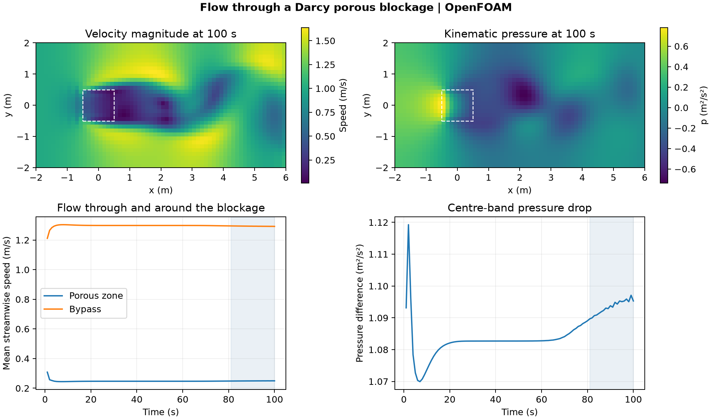

# Flow through a Darcy porous blockage

This planar OpenFOAM Foundation 14 model sends a 1 m/s stream through an 8 m by 4 m section with a 1 m square porous zone. The laminar model uses a kinematic viscosity of 0.005 m²/s, an isotropic Darcy resistance of 1,000 m⁻², and zero Forchheimer resistance. The empty-plane extrusion is 0.2 m.

## Results

Over the 20 saved samples from 81 to 100 s, the mean streamwise speed was **0.249 m/s inside the porous zone** and **1.294 m/s in the bypass region**. The zone speed was 19.3% of the bypass speed. The mean centre-band kinematic pressure drop was **1.093 m²/s²**, measured between cell columns at x = −0.5625 and +0.5625 m over |y| &lt; 0.5 m. The bypass average uses cells within the same streamwise span as the zone and |y| &gt; 1 m.

## Numerical checks

The 2,048-cell mesh passed the native mesh check. The 64 zone cell IDs matched the centred box. The solver completed 2,000 steps, and all 100 saved states passed clock, finite-field and inlet/outlet flux checks. The largest relative volume-flow mismatch was 6.25 × 10⁻⁷. The late samples represent a finite observation window on one mesh.

[Run script](run.sh) · [Audit script](audit.py) · [Numerical checks](data/checks.json) · [Flow history](data/porous-history.csv) · [Figure PDF](data/porous-blockage.pdf)

The run script takes an absolute path to a new case directory and uses the installed [OpenFOAM Foundation tutorial](https://github.com/OpenFOAM/OpenFOAM-14/tree/master/tutorials/incompressibleFluid/porousBlockage). The audit takes the case directory, the [native field reader](../../lessons/48-planar-diffuser-recovery/audit_diffuser_v003.py), and a new result directory.
