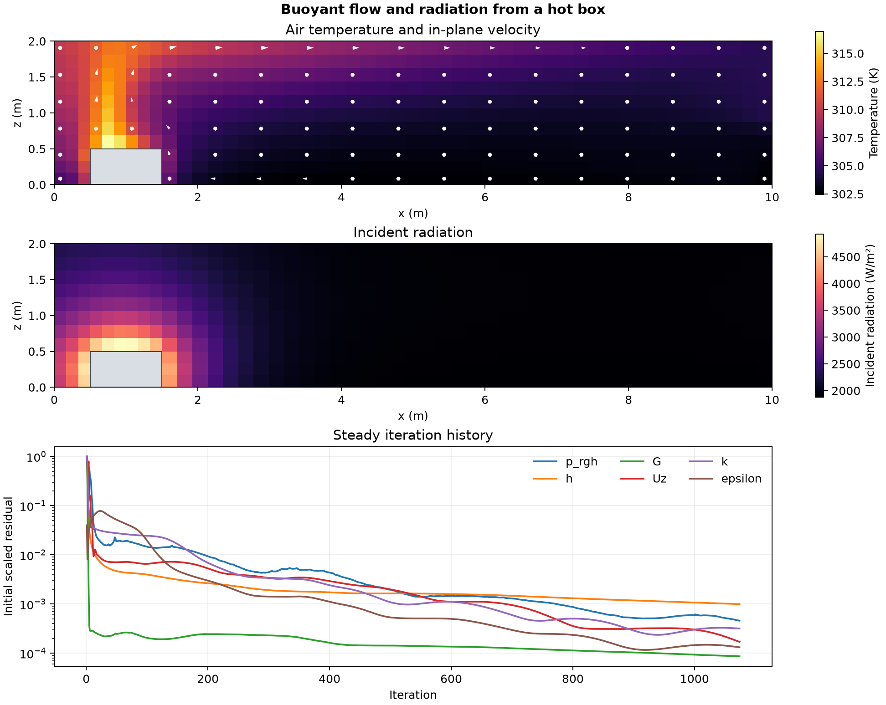

# Buoyant flow and radiation from a hot box

A 500 K box sits on the floor of a closed 10 m by 6 m by 2 m room. The floor and ceiling have prescribed temperatures of 300 K. The side walls have zero normal temperature gradient. The calculation couples buoyant ideal-gas flow and a k–epsilon closure with the native P1 radiation model. This run uses 15,523 cells on a reduced version of the tutorial mesh. [OpenFOAM Foundation 14 case](https://github.com/OpenFOAM/OpenFOAM-14/tree/master/tutorials/fluid/hotRadiationRoom)

The maps show air temperature and incident radiation on the cell row at y ≈ 0.917 m. The arrows show in-plane velocity and the grey area marks the box. The residual history uses steady solver iterations.

The average incident radiation in the volume directly above the box was 3.90 kW/m², compared with 1.90 kW/m² in the far sample at the same heights. Mean air temperatures in those samples were 310.21 and 303.58 K. The original cap of 1,000 iterations left the enthalpy residual slightly above its target. A continuation from the saved checkpoint converged at iteration 1,074 with the original thresholds. The native closed-wall flux check passed.

This case describes the coupled solution on one mesh. The incident radiation field is distinct from net surface heat flux. The calculation provides no separate estimate of the effect of radiation on the flow.

To reproduce, pass the same absolute path to an existing workspace directory to the initial and continuation scripts in that order.

[Residual history](data/radiating-room-history.csv) · [Numerical checks](data/checks.json) · [Figure PDF](data/radiating-room.pdf) · [Initial run](run.sh) · [Continuation](continue.sh) · [Audit](audit.py)
