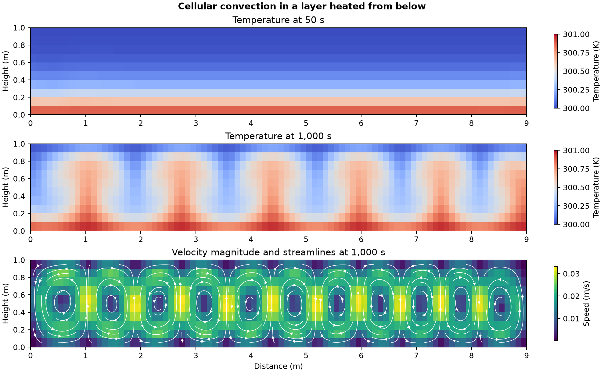

# Convection rolls in a layer heated from below

How does a nearly still fluid layer develop alternating rolls when the lower wall is warmer than the upper wall?

## Model and checks

OpenFOAM Foundation 14 ran its [horizontal-layer convection tutorial](https://github.com/OpenFOAM/OpenFOAM-14/tree/master/tutorials/fluid/BernardCells). The planar layer is 9 m long and 1 m high, with 900 cells. The bottom is held at 301 K, the top at 300 K and the sides are insulated. The native laminar Boussinesq model starts at 300 K with a small horizontal velocity of 0.0001 m/s. Heating from below gives the buoyancy-driven configuration analyzed by Rayleigh. [Rayleigh, On convection currents in a horizontal layer of fluid](https://www.tandfonline.com/doi/abs/10.1080/14786441608635602)

The mesh check passed, and all 1,000 physical steps and twenty saved states were checked. The saved interior temperatures stayed within the stated bounds, the out-of-plane velocity was zero and the final pressure correction reported a local continuity error of 3.05 × 10⁻¹⁰.

## Result

At 50 s, vertical speed was small and the temperature varied mainly with height. By 1,000 s, alternating warm upwellings and cool downwellings crossed the layer. The mid-height vertical velocity ranged from **−0.0326 to +0.0328 m/s**. Among mid-height samples faster than 0.001 m/s in either vertical direction, the direction changed 11 times across the layer. The floor gradient estimated from the wall and adjacent row was **2.70 times** the nominal conduction gradient.

The temperature plots share a colour scale. The streamlines follow the saved 1,000 s velocity field. The floor ratio uses a one-sided estimate on a coarse mesh. It describes this calculation and does not establish grid-independent heat transfer or a measured onset threshold.

## Files

- [Saved temperature and velocity checks](data/convection-roll-history.csv)
- [Numerical checks and native source hashes](data/checks.json)
- [Vector figure](data/rayleigh-benard-rolls.pdf)
- [Case runner](run.sh) and [analysis script](audit.py)

Run the shell script with an absolute path to a new case directory whose parent exists. Pass the case directory, the repository's [native field reader](../../lessons/48-planar-diffuser-recovery/audit_diffuser_v003.py) and a new output directory to the Python analysis script. The analysis uses NumPy and Matplotlib.

[Return to the project index](../../docs/MODEL_INDEX.md)
