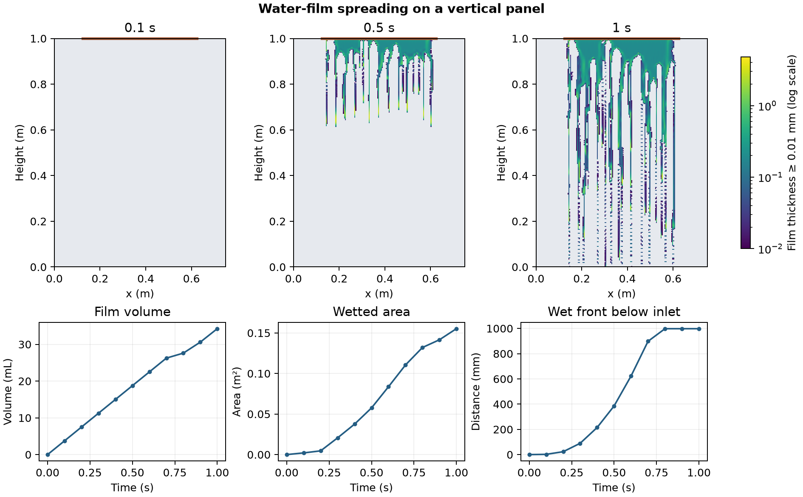

# Water-film spreading on a vertical panel

Water enters across the central 0.5 m of a 0.75 m by 1 m vertical panel that starts dry. The inlet prescribes a downward speed of 0.075 m/s and a reference thickness of 1 mm, with the tutorial’s thickness fluctuations. The model uses the native gravitational contact-angle law and surface tension of 0.07 N/m. [OpenFOAM Foundation 14 case](https://github.com/OpenFOAM/OpenFOAM-14/tree/master/tutorials/isothermalFilm/rivuletPanel)

The maps show the saved film thickness on a common logarithmic scale. Grey indicates thickness below 0.01 mm. The orange line marks the inlet. The wet front is the farthest cell centre below the inlet with thickness of at least 0.01 mm. It reached the bottom row by the 0.8 s save.

At 1 s, the panel held 34.26 mL of water and had 0.1552 m² of wetted area at that threshold. The 43,200-cell run completed 2,469 time steps. All ten saves passed the thickness-to-fraction conversion, inlet flux, volume and front checks. The strict zero floor flagged a minimum of −3.55 × 10⁻¹³ m. The signed fields passed the separate 10⁻¹² m tolerance, with a largest magnitude negative volume of 1.26 × 10⁻¹⁷ m³. The numerical files preserve those values.

The model resolves thickness on the wall. The inlet and outlet mass fluxes in the data are sampled at saved times. Rivulet spacing and arrival time are specific to this mesh, inlet fluctuation setting and contact-angle law.

[Saved data](data/film-history.csv) · [Numerical checks](data/checks.json) · [Figure PDF](data/rivulet-panel.pdf) · [Run script](run.sh) · [Audit script](audit.py)
