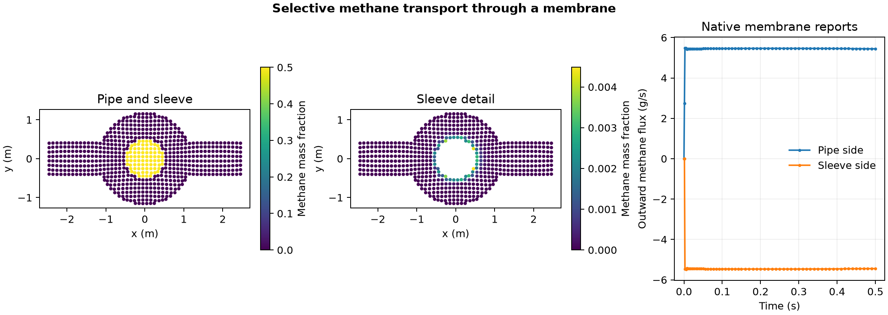

# Selective methane transport through a membrane

A methane and nitrogen stream flows through a pipe surrounded by an air sleeve. The OpenFOAM Foundation 14 [membrane case](https://github.com/OpenFOAM/OpenFOAM-14/tree/master/tutorials/multicomponentFluid/membrane) uses a selective transfer condition at the two facing membrane patches. The two inlet flows are perpendicular and each has a prescribed speed of 1 m/s.

The plots on the left show saved cell centres in the slab 0 ≤ z < 0.1 m at 0.5 s. The middle panel uses a separate colour scale to make the methane entering the sleeve visible. The plot on the right shows the native flux reports, with outward normals defined separately for the pipe and sleeve.

At 0.5 s, methane flux was +5.44266 g/s on the pipe side and −5.44286 g/s on the sleeve side, a relative mismatch of 0.00357%. The volume-weighted methane mass fraction in the sleeve was 0.0160%. The first reported advance shows a startup imbalance, so the terminal flux match does not establish conservation over the whole interval.

The calculation advanced 63 steps on a mesh of 18,632 cells. Checks covered ten saved states, all three species mass fractions, pressure, temperature, and the geometric match between the 960 faces on each membrane side. Native report traces include startup. These checks do not establish mesh independence, heat balance, or experimental validation.

[Saved-state data](data/membrane-history.csv) · [Native flux reports](data/native-membrane-flux.csv) · [Numerical checks](data/checks.json) · [Figure PDF](data/selective-methane-membrane.pdf) · [Run script](run.sh) · [Audit script](audit.py)
