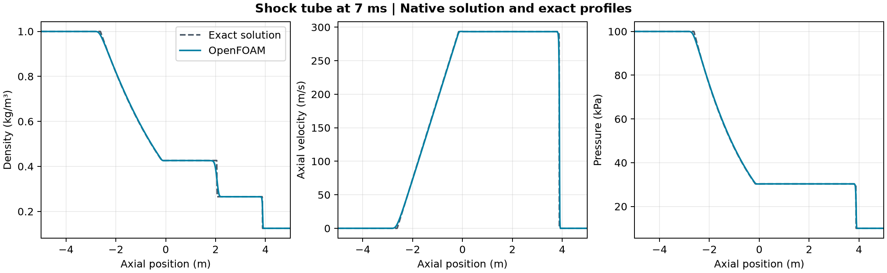

# Shock tube

A pressure jump in a 10 m tube generates a rarefaction, a contact discontinuity and a shock. This project tracks those waves using the `shockFluid` solver in OpenFOAM Foundation 14 and compares the saved profiles with the exact Riemann solution for the same initial states.

| Quantity at 7 ms | OpenFOAM | Exact reference |
| --- | ---: | ---: |
| Contact position | 2.060 m | 2.053 m |
| Shock position | 3.890 m | 3.879 m |

The mean absolute pressure error was **0.110% of the initial high pressure**. All seven saved states passed the finite field, positive density and temperature, ideal-gas and time checks. The largest relative discrepancies in total mass and energy from the prescribed initial state were **6.0 × 10⁻⁷** and **7.0 × 10⁻⁶**, respectively. Both end states remained undisturbed during this comparison.

## Model

The tube is 10 m long with 1,000 equal axial cells and empty transverse faces. It starts at rest and uses zero-gradient conditions at both ends. The left and right pressures are 100 kPa and 10 kPa, and the temperatures are 348.432 K and 278.746 K. The perfect gas has zero viscosity in this case. The native solver advanced 1,400 steps of 5 µs and wrote the fields every 1 ms. The figure uses the saved cell values and cell-averaged exact profiles. Wave positions use peak gradients inside fixed windows around the exact waves.

The calculation uses one grid and a short interval before the waves reach the tube ends. The comparison evaluates this idealized initial-value problem.

## Reproduction and data

Copy the [OpenFOAM shock-tube tutorial](https://github.com/OpenFOAM/OpenFOAM-14/tree/master/tutorials/shockFluid/shockTube) input folders into a new writable case. Set `writePrecision` to 12 in `system/controlDict`, run `blockMesh` and `checkMesh`, then write cell centres with `foamPostProcess -func writeCellCentres -time 0` and run `foamRun`. From the repository root, run the case with `bash projects/shock-tube/run.sh /absolute/path/to/new-case`. Then run `python projects/shock-tube/audit.py /absolute/path/to/new-case lessons/50-sod-shock-tube/solve_sod.py new-audit-output` with NumPy and Matplotlib.

- [Numerical checks](data/checks.json) · [Endpoint data](data/endpoint-profiles.csv) · [Figure PDF](data/openfoam-shock-tube.pdf)
- [Companion Python benchmark and exact Riemann solver](../../lessons/50-sod-shock-tube/README.md)
