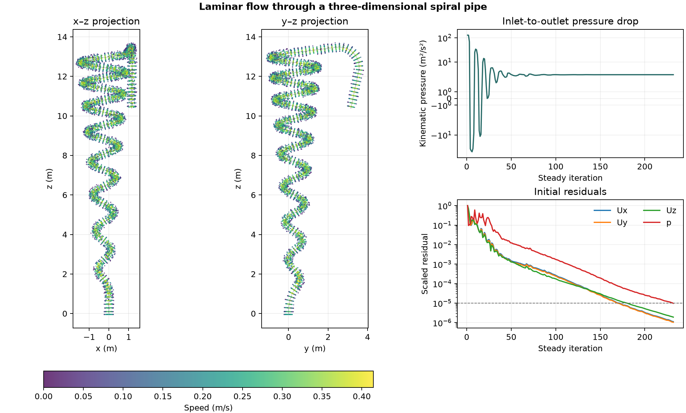

# Laminar flow through a three-dimensional spiral pipe

The pipe has a 0.5 m diameter and follows a curved path about 47.60 m long, plus a 0.10 m inlet section. The mesh uses the native path and cross section with 250 extrusion layers. The calculation prescribes 0.04 m³/s at the inlet, zero gauge kinematic pressure at the outlet and no slip on the pipe wall. Kinematic viscosity is 0.0025 m²/s. [OpenFOAM Foundation 14 mesh example](https://github.com/OpenFOAM/OpenFOAM-14/tree/master/tutorials/mesh/spiralPipe)

The left panels project the same sampled cell centres onto two planes. Colour represents speed at the converged state. The pressure history uses a symmetric logarithmic axis to show the early iteration swings and the later positive pressure drop. The iterations are part of the steady solution procedure.

OpenFOAM converged in 232 iterations on 112,448 cells. The inlet-to-outlet kinematic pressure drop was 3.536 m²/s². The outlet flow was 0.03999997 m³/s and the relative flux imbalance was 6.92 × 10⁻⁷. The volume-weighted RMS velocity change from the previous save at iteration 225 was 5.78 × 10⁻⁶ m/s.

The run describes the prescribed laminar flow on one mesh. It includes neither a separate straight-pipe calculation nor a comparison against measured losses.

To reproduce, pass the same absolute path to an existing workspace directory to the mesh, patch and run scripts in that order.

[Iteration history](data/spiral-pipe-history.csv) · [Numerical checks](data/checks.json) · [Figure PDF](data/spiral-pipe.pdf) · [Mesh](prepare-mesh.sh) · [Patches](prepare-patches.sh) · [Run](run.sh) · [Audit](audit.py)
