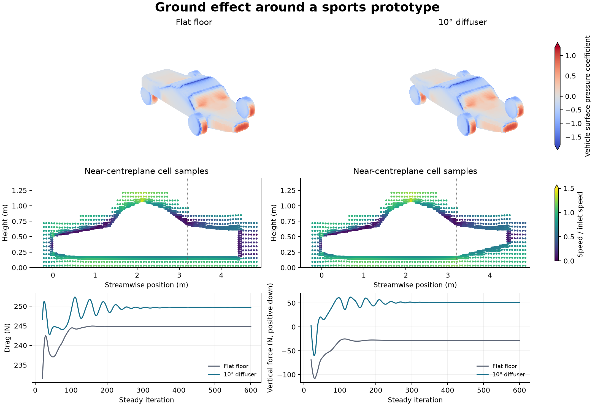

# Ground effect around a sports prototype

This three-dimensional OpenFOAM study compares a flat underfloor with a 10° rear diffuser on an idealized closed-cockpit sports prototype. The 4.4 m body has four exposed wheels and a 0.18 m flat-floor clearance. The rear ramp starts at 3.20 m. Both configurations use 25 m/s freestream and moving ground. Wheel rotation is imposed on the fixed wheel surfaces. Each wheel clears the ground by 60 mm and uses an angular speed of 78.125 rad/s.

| Configuration | Mesh cells | Drag | Vertical force |
| --- | ---: | ---: | ---: |
| Flat floor | 134,514 | 244.84 N | 28.26 N lift |
| 10° rear diffuser | 134,628 | 249.62 N | 51.09 N downforce |

The diffuser shifted vertical force by **79.35 N downward** and increased drag by **1.95%**. The mean pressure coefficient on the sampled floor just ahead of the ramp dropped from −0.083 to −0.263. Forces include the chassis and all four wheels. The table averages the final 50 of 600 steady iterations. Coefficients use a 1 m² reference area and 1.225 kg/m³ reference density.

The meshes use the same refinement rules and each passed the native mesh check. Both steady SST RANS runs passed the declared terminal residual, mass-flow, wheel-motion and force-stability checks. The audit independently integrates pressure from the mesh faces and compares it with the native force reports. The figure shows the solved surface pressure and actual cell-centre speed samples on common scales. Mesh sensitivity, the absence of prism layers, and the clearance under the simplified wheels limit quantitative application to a real car. This configuration is an original idealized geometry. The diffuser experiment below motivates the comparison.

[PDF figure](figures/sports-prototype.pdf) · [Force histories](data/forces.csv) · [Residuals](data/initial-residuals.csv) · [Checks](data/checks.json)

Run the shell script with a new absolute case path and an angle of 0 or 10. It uses Foundation 14, Python 3 and the installed motorBikeSteady spatial and pressure-velocity dictionaries. The Python audit takes the completed flat and diffuser case paths, the shared field reader and a new output directory.

[Case generator](method/prepare-prototype.py) · [Run script](method/run-prototype.sh) · [Audit](method/audit-prototype-v005.py) · [Shared field reader](../../lessons/48-planar-diffuser-recovery/audit_diffuser_v003.py) · [Moving-ground diffuser experiments](https://researchportal.hkust.edu.hk/en/publications/influence-of-diffuser-angle-on-a-bluff-body-in-ground-effect/)
