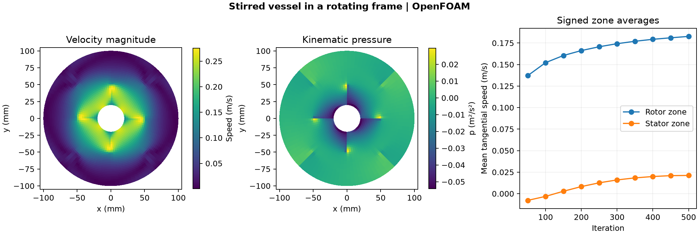

# Stirred vessel in a rotating frame

A central rotor turns at 60 rpm inside a baffled vessel. The OpenFOAM Foundation 14 incompressible model uses a steady rotating reference frame for the inner zone and a stationary outer zone, with k–epsilon turbulence closure. The hub, rotor blade tip and vessel wall radii are 20, 50 and 100 mm. The stator blade tips are at 70 mm. The empty-plane slab is 10 mm deep.

## Results

At iteration 500 the volume-weighted signed tangential velocity is **0.183 m/s in the rotor zone** and **0.0212 m/s in the stator zone**. The averages project the native velocity onto the positive tangential direction around the shaft. The maximum cell speed is 0.276 m/s. The plots show the terminal fields and the evolution of the zone averages with solver iteration.

## Numerical checks

The mesh passed the native check with 3,072 cells, split equally between the rotor and stator zones. The run completed 500 iterations and all ten saved states passed the clock and field checks. The volume-weighted RMS velocity change from iterations 450 to 500 was 0.00264 m/s. The terminal pressure solve gave a local continuity error of 5.97 × 10⁻⁹.

The stock pressure relative tolerance gave a terminal local continuity error of 4.38 × 10⁻⁴, above the 10⁻⁴ criterion. The published case retains the pressure absolute tolerance of 10⁻⁸ and sets the relative tolerance to zero. The fixed rotor model and single mesh support a steady-flow comparison of the zones. The iteration history describes the solver, and the calculation does not resolve blade motion in physical time.

[Run script](run.sh) · [Audit script](audit.py) · [Numerical checks](data/checks.json) · [Zone histories](data/stirred-vessel-history.csv) · [Figure PDF](data/stirred-vessel.pdf)

The run script takes an absolute path to a new case directory and uses the installed [OpenFOAM Foundation tutorial](https://github.com/OpenFOAM/OpenFOAM-14/tree/master/tutorials/incompressibleFluid/mixerVessel2DMRF) and its shared mesh dictionary. The audit takes the case directory, the [native field reader](../../lessons/48-planar-diffuser-recovery/audit_diffuser_v003.py), and a new result directory.
