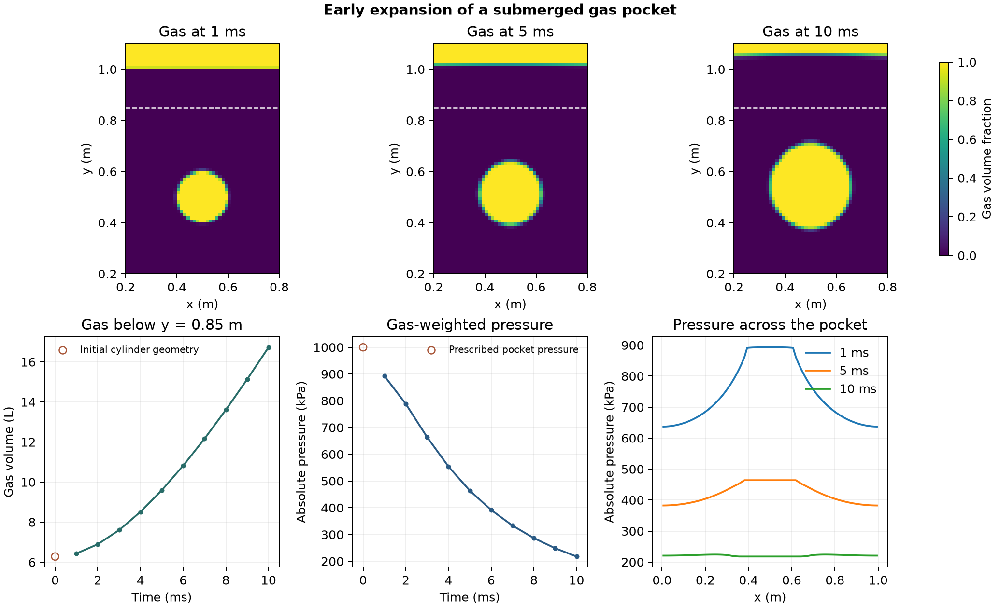

# Early expansion of a submerged gas pocket

A cylindrical gas pocket starts at 1 MPa and 578 K inside a sealed, partly water-filled tank. The background starts at 0.1 MPa and 300 K. The tank is 1 m wide and 2 m high. The planar calculation uses a 0.2 m extrusion, so the reported volumes refer to that thickness. [OpenFOAM Foundation 14 case](https://github.com/OpenFOAM/OpenFOAM-14/tree/master/tutorials/compressibleVoF/depthCharge2D)

The maps show the native gas fraction at 1, 5 and 10 ms. The dashed line bounds the lower sample used to separate the pocket from the headspace. The pressure profile averages the two cell rows closest to the initial pocket centre at y = 0.5 m.

At 10 ms, the lower sample contained 16.73 L of gas, 2.66 times the 6.28 L geometric volume of the prescribed initial cylinder. Its gas-weighted absolute pressure was 218 kPa. OpenFOAM completed 53 time steps on 12,800 cells. All ten saves passed the phase-fraction and thermodynamic checks.

The reference markers at zero show the prescribed pressure and geometric cylinder volume. The calculation covers the initial expansion over 10 ms with the specified thermodynamics and boundaries.

[Saved data](data/gas-pocket-history.csv) · [Numerical checks](data/checks.json) · [Figure PDF](data/submerged-gas-expansion.pdf) · [Run script](run.sh) · [Audit script](audit.py)
