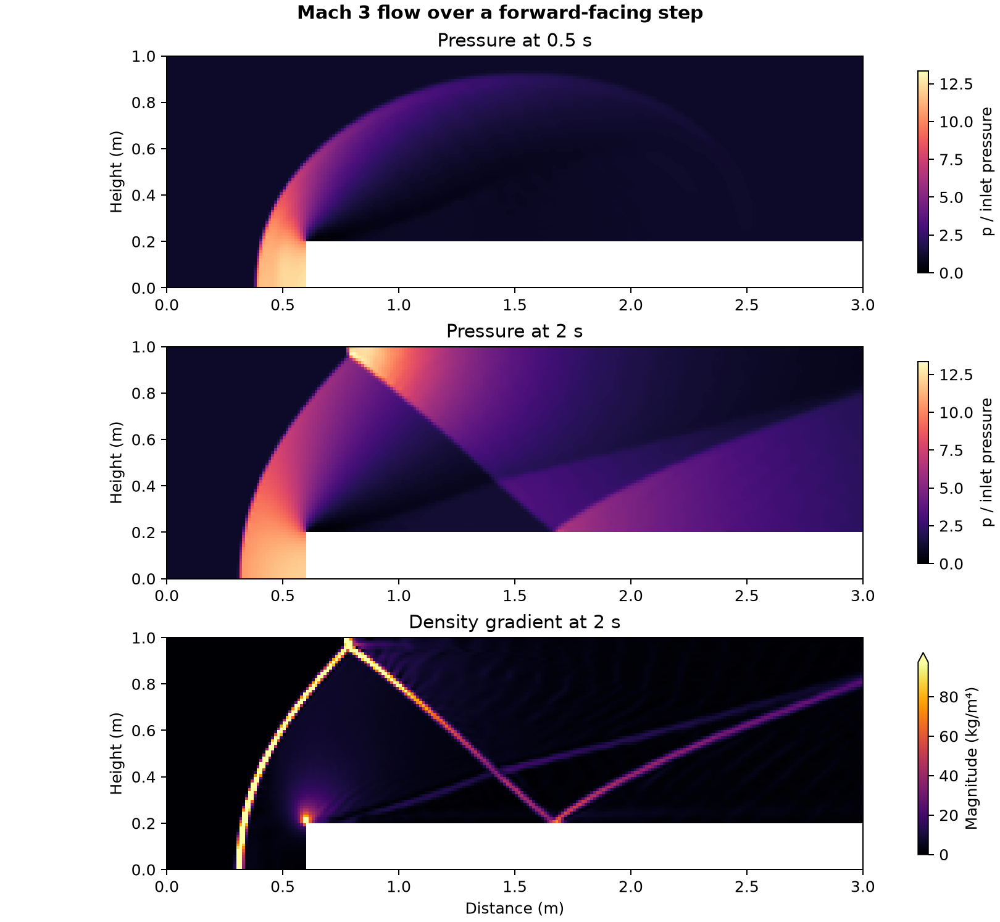

# Mach 3 flow over a forward-facing step

How does the shock generated by a step develop and interact with the tunnel ceiling?

## Setup and checks

OpenFOAM Foundation 14 ran the [shockFluid forward-step tutorial](https://github.com/OpenFOAM/OpenFOAM-14/tree/master/tutorials/shockFluid/forwardStep) on its 16,128-cell planar mesh. The inviscid perfect gas has nominal inlet Mach 3, initial sound speed near 1 m/s and an inlet pressure scale of 1 Pa. These are the tutorial's normalized gas properties. The step begins 0.6 m from the inlet and is 0.2 m high. The run used the native Kurganov flux and adaptive time stepping, through the first 2 s of the benchmark. [Woodward and Colella, The numerical simulation of two-dimensional fluid flow with strong shocks](https://crd.lbl.gov/assets/pubs_presos/AMCS/ANAG/A31984.pdf)

The mesh check passed. All 3,481 advancing clocks and twenty saved states were checked. Each saved velocity field was finite and pressure, temperature and density were positive. Native saved density agreed with the ideal-gas reconstruction within 10⁻⁶ relative. The solver logged a maximum Courant value of 0.56 during startup before adjusting the step toward the 0.2 target.

## Result

The bow shock is visible upstream of the step at 0.5 s. A ceiling strip of five consecutive cells exceeded 1.25 times inlet pressure at the **0.6 s** save, the first sample meeting that criterion. At 2 s, the pressure and density-gradient fields show the incident wave and reflections from the upper wall and step surface. Peak interior pressure at that save was **13.34 times** inlet pressure. The density-gradient panel uses fluid-cell differences and saturates the highest one percent to show weaker structures. This two-second calculation on one mesh describes the computed wave pattern. Shock-position error and grid convergence would need separate comparisons.

## Files

- [Saved shock history](data/shock-step-history.csv)
- [Numerical checks and native source hashes](data/checks.json)
- [Vector figure](data/supersonic-forward-step.pdf)
- [Case runner](run.sh) and [analysis script](audit.py)

Run the shell script with an absolute path to a new case directory whose parent exists. Pass the case directory, the repository's [native field reader](../../lessons/48-planar-diffuser-recovery/audit_diffuser_v003.py) and a new output directory to the Python script. The analysis uses NumPy and Matplotlib.

[Return to the project index](../../docs/MODEL_INDEX.md)
