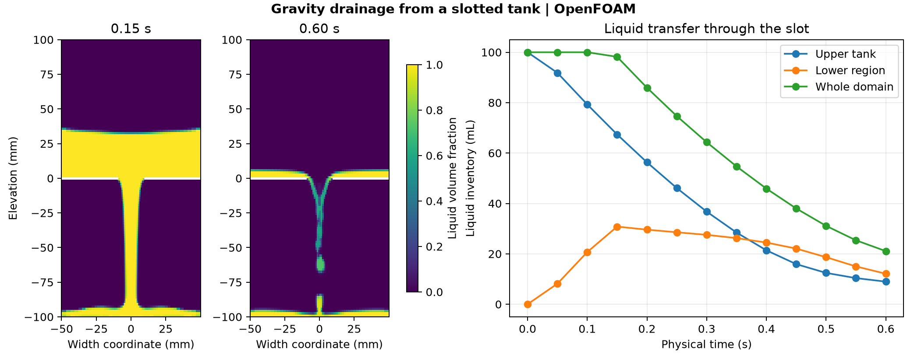

# Gravity drainage from a slotted tank

A 100 mm wide tank starts with a 50 mm liquid head above a 20 mm slot. Gravity pulls liquid into the lower region, where it spreads across the floor and can leave through the open sides. The OpenFOAM Foundation 14 volume-of-fluid model uses the planar container discharge tutorial. The laminar liquid has density 950 kg/m³ and kinematic viscosity 10⁻⁴ m²/s. The model uses surface tension of 0.07 N/m and gravity of 9.81 m/s².

## Results

The upper tank contains **8.98 mL of its initial 100 mL** at 0.60 s. Its net loss is 91.02 mL. The lower region reaches 30.81 mL at 0.15 s and holds 12.11 mL at 0.60 s. The white lines in the figure mark the solid portions of the tank base. The reported volumes use the model's 20 mm extrusion depth and integrate the saved liquid fraction over the native cell volumes. The decrease in whole-domain inventory includes liquid leaving the open domain. The inventory data alone do not provide an independent boundary flux balance.

## Numerical checks

The mesh passed the native check with 7,200 cells. The run completed 1,459 adaptive steps to 0.60 s. All twelve saved states passed the clock, finite field and phase-fraction checks. The maximum logged bulk and interface Courant numbers were 0.567 and 0.515, respectively, with adaptive targets of 0.5. The case uses a single mesh and captures a finite drainage interval.

[Run script](run.sh) · [Audit script](audit.py) · [Numerical checks](data/checks.json) · [Inventory history](data/drainage-history.csv) · [Figure PDF](data/tank-drainage.pdf)

The run script takes an absolute path to a new case directory. It adjusts the [OpenFOAM Foundation tutorial](https://github.com/OpenFOAM/OpenFOAM-14/tree/master/tutorials/incompressibleVoF/containerDischarge2D) time controls while retaining its geometry, boundary conditions and physical inputs. The audit takes the case directory, the [native field reader](../../lessons/48-planar-diffuser-recovery/audit_diffuser_v003.py), and a new result directory.
