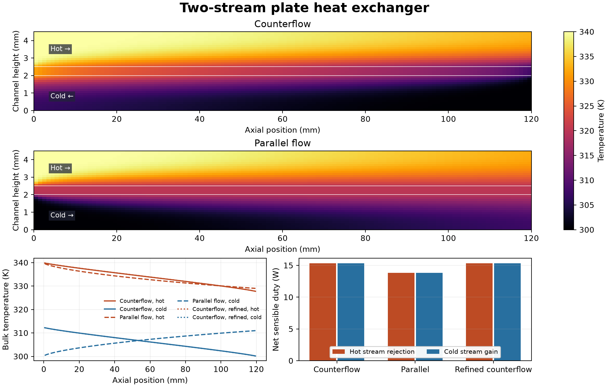

# Two-stream plate heat exchanger

Two laminar water streams exchange heat through a stainless-steel plate in a steady OpenFOAM Foundation 14 model. Each channel is 120 mm long and 2 mm high. The plate is 0.5 mm thick, and the planar calculation uses a 10 mm reference width. The streams enter at 340 K and 300 K with equal flow rates of 0.300 g/s. Only the cold inlet and outlet are exchanged between the two baseline cases.

| Arrangement | Cells across three regions | Heat duty | Effectiveness | Pressure drop per stream |
| --- | ---: | ---: | ---: | ---: |
| Counterflow | 4,320 | 15.349 W | 30.60% | 5.378 Pa |
| Parallel flow | 4,320 | 13.810 W | 27.53% | 5.378 Pa |
| Counterflow, refined | 9,720 | 15.354 W | 30.61% | 5.395 Pa |

Counterflow transferred 11.1% more heat than parallel flow on the matched mesh. Refinement changed its net sensible duty by 0.029%. The analytical fully developed pressure drop between parallel plates is 5.400 Pa at this flow rate. The computed drops use the native outlet gauge pressure and an inlet estimate extrapolated from the first cell plane over half a cell.

Each case ran 900 steady iterations and saved nine computed states. The audit integrates the native face mass flux and sensible enthalpy at the stream ports, with axial conduction computed from the boundary temperature and first cell. Hot rejection and cold gain are each reported in the data. The table averages them. Their terminal relative mismatch was below 2.34e-7 in all three cases. The audit also compares the face temperatures and orthogonal heat fluxes reconstructed on both sides of each mapped interface. Effectiveness uses the smaller heat capacity rate and the 40 K inlet temperature difference. These are sensible heat and numerical checks for the stated planar, constant-property model. Real manifolds, three-dimensional side walls, and experimental data lie outside the case.

[PDF figure](figures/plate-exchanger.pdf) · [Port histories](data/port-history.csv) · [Temperature profiles](data/temperature-profiles.csv) · [Numerical checks](data/checks.json)

With Foundation 14 and Python 3 installed, run the shell script with a new absolute case path, an arrangement of counter or parallel, and a mesh level of base or fine. The Python audit takes the parent of the three cases, the shared field reader and a new output directory.

[Case generator](method/prepare-plate-exchanger.py) · [Run script](method/run-plate-exchanger-v002.sh) · [Audit](method/audit-plate-exchanger-v003.py) · [Shared field reader](../../lessons/48-planar-diffuser-recovery/audit_diffuser_v003.py) · [Heat exchanger effectiveness reference](https://handbook.ashrae.org/Handbooks/F21/SI/f21_ch04/F21_Ch04_si.aspx)
