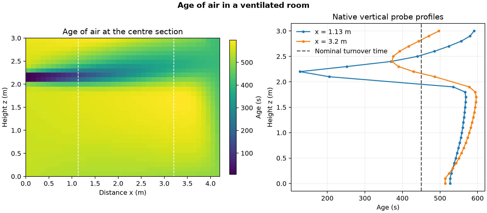

# Age of air in a ventilated room

How does the time since air entered vary between a supply jet and the lower room?

## Setup and checks

OpenFOAM Foundation 14 used the [room residence-time tutorial](https://github.com/OpenFOAM/OpenFOAM-14/tree/master/tutorials/incompressibleFluid/roomResidenceTime), a 4.2 m by 3.6 m by 3 m room with a supply slot and an outlet. The 53,820-cell mesh used the native k–ε closure, wall functions and 1.68 m/s inlet. The steady flow reached the solver's residual criteria at iteration 573, and all three saved flow states passed the field and clock checks.

The terminal signed inlet and outlet flows were −0.1008000 and 0.1007999 m³/s. Their mismatch was about 9.9 × 10⁻⁷ relative to inlet flow. The age equation used the saved flow with diffusion enabled. Its final linear residual was 9.53 × 10⁻⁹, and the audit verified both native probe profiles against the saved cell values. [OpenFOAM age function source](https://github.com/OpenFOAM/OpenFOAM-14/tree/master/src/functionObjects/solvers/age)

## Result

The nominal room turnover time V/Q was **450 s**. The computed volume-weighted mean age was **555 s**, with **419 s** in the specified region near the supply and **581 s** in the sampled lower interior. The age dip near the supply-jet height is visible in both the section and the probe profiles. The section averages the two adjacent cell layers at y = 1.8 m. These values describe a steady advection–diffusion calculation on one mesh. They do not measure an individual parcel's trajectory or verify ventilation performance in a physical room.

## Files

- [Native age probe profiles](data/age-profiles.csv)
- [Numerical checks, sampling regions and native source hashes](data/checks.json)
- [Vector figure](data/ventilation-age.pdf)
- [Case runner](run.sh) and [analysis script](audit.py)

Run the shell script with an absolute path to a new case directory whose parent exists. Pass the case directory, the repository's [native field reader](../../lessons/48-planar-diffuser-recovery/audit_diffuser_v003.py) and a new output directory to the Python analysis script. The analysis uses NumPy and Matplotlib.

[Return to the project index](../../docs/MODEL_INDEX.md)
