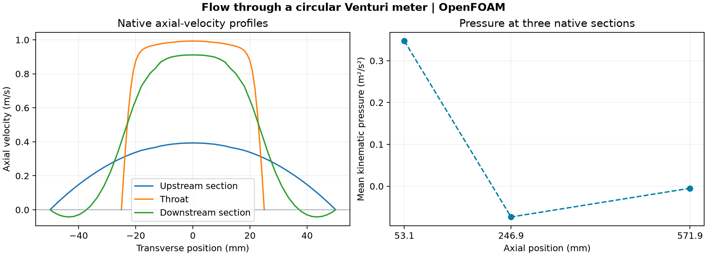

# Circular Venturi meter

A circular passage narrows from 100 mm to 50 mm and then expands to its original diameter. The OpenFOAM calculation measures the speed increase, pressure drop and downstream recovery in a steady laminar flow.

| Section | Axial position | Mean axial speed | Mean kinematic pressure |
| --- | ---: | ---: | ---: |
| Upstream | 53.125 mm | 0.2000 m/s | 0.34710 m²/s² |
| Throat | 246.875 mm | 0.7994 m/s | −0.07368 m²/s² |
| Downstream | 571.875 mm | 0.2000 m/s | −0.00505 m²/s² |

The mean axial speed increased by a factor of 4.00 at the throat, consistent with the area ratio. The upstream-to-throat pressure drop was 0.42078 m²/s². The ideal Bernoulli estimate based on the section mean speeds is 0.29951 m²/s². The model includes viscosity and nonuniform velocity profiles. Kinematic pressure recovered by 0.06863 m²/s² between the throat and the downstream section, where the sampled velocity profile includes reverse flow near the walls. The dashed line connects three pressure samples.

## Setup and checks

The 3D model uses the OpenFOAM Foundation 14 Venturi tutorial with 57,600 cells, kinematic viscosity 4 × 10⁻⁵ m²/s, prescribed mean inlet velocity 0.2 m/s, no-slip walls and a zero outlet total-pressure reference. The native residual criterion of 10⁻⁵ stopped the run at 350 iterations. The inlet/outlet volume-flux mismatch was 9.35 × 10⁻⁷ relative to the inlet flow. The volume-weighted RMS change in velocity between iterations 300 and 350 was 1.48 × 10⁻⁵ m/s. Pressure means use volume weights within individual straight sections with constant axial spacing, which gives area weighting. The three velocity profiles are native line samples at 50, 250 and 575 mm.

The comparison uses one mesh and one inlet speed. The results describe this numerical case. [Venturi tutorial background](https://doc.cfd.direct/notes/cfd-general-principles/venturi-tube).

## Reproduction and data

Use `bash projects/venturi-meter/run.sh /absolute/path/to/new-case` from the repository root with OpenFOAM Foundation 14 installed. The runner uses the installed Venturi tutorial, verifies the mesh, writes cell centres and volumes, and retains the native solver log. To repeat the audit, run `python projects/venturi-meter/audit.py /absolute/path/to/new-case lessons/48-planar-diffuser-recovery/audit_diffuser_v003.py new-audit-output` with NumPy and Matplotlib.

[Checks](data/checks.json) · [Native line-sample data](data/velocity-sections.csv) · [Figure PDF](data/venturi-comparison.pdf)
