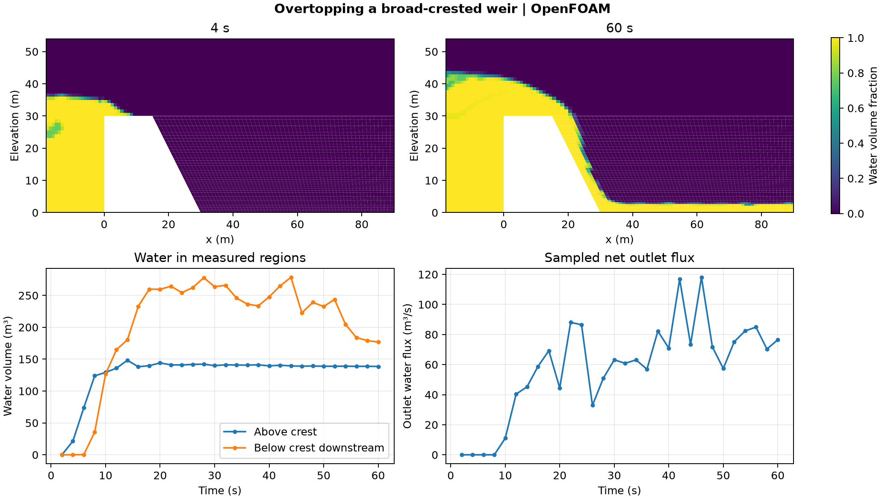

# Overtopping a broad-crested weir

The model follows water as it rises from an initial upstream depth of 20 m, crosses a 30 m high crest, and flows down the downstream face. The planar channel has a 1 m extrusion depth and a prescribed inlet water flow of 75 m³/s. The downstream end uses zero gauge total pressure, a pressure-driven velocity condition, and air for reverse flow. The OpenFOAM Foundation 14 model uses a two-phase volume-of-fluid solver and k–epsilon turbulence closure.

## Results

Water first registered above the crest in the saved 4 s state. The below-crest downstream measurement registered water at a later saved state, 6 s. Both observations use a 10⁻⁶ m³ detection threshold and 2 s output spacing. The saved net water flux through the outlet first exceeded 1 m³/s at 10 s. It reached **76.48 m³/s at 60 s**, with a maximum sampled value of **118.06 m³/s**. The outlet series sums the signed native water phase flux over 64 faces. It is a set of instantaneous samples.

## Numerical checks

The mesh passed the native check with 5,080 cells. The run completed 13,911 steps to 60 s. All 30 saved states passed clock, finite-field and water-fraction checks. The maximum logged bulk and interface Courant numbers were 0.244 and 0.223, respectively. The plots use the actual front-plane cell polygons, checked against the saved cell centres and volumes.

The original tutorial outlet was also tested. That run missed the declared water-fraction tolerance at 28 s, with a maximum of 1.000001016 against a limit of 1.000001. The published run uses the pressure-driven outlet described above, so its results apply to that boundary choice and a single mesh.

[Run script](run.sh) · [Audit script](audit.py) · [Numerical checks](data/checks.json) · [Weir history](data/weir-history.csv) · [Figure PDF](data/weir-overflow.pdf)

The run script takes an absolute path to a new case directory. It modifies the downstream patch of the [OpenFOAM Foundation tutorial](https://github.com/OpenFOAM/OpenFOAM-14/tree/master/tutorials/incompressibleVoF/weirOverflow). The audit takes the case directory, the [native field reader](../../lessons/48-planar-diffuser-recovery/audit_diffuser_v003.py), and a new result directory.
