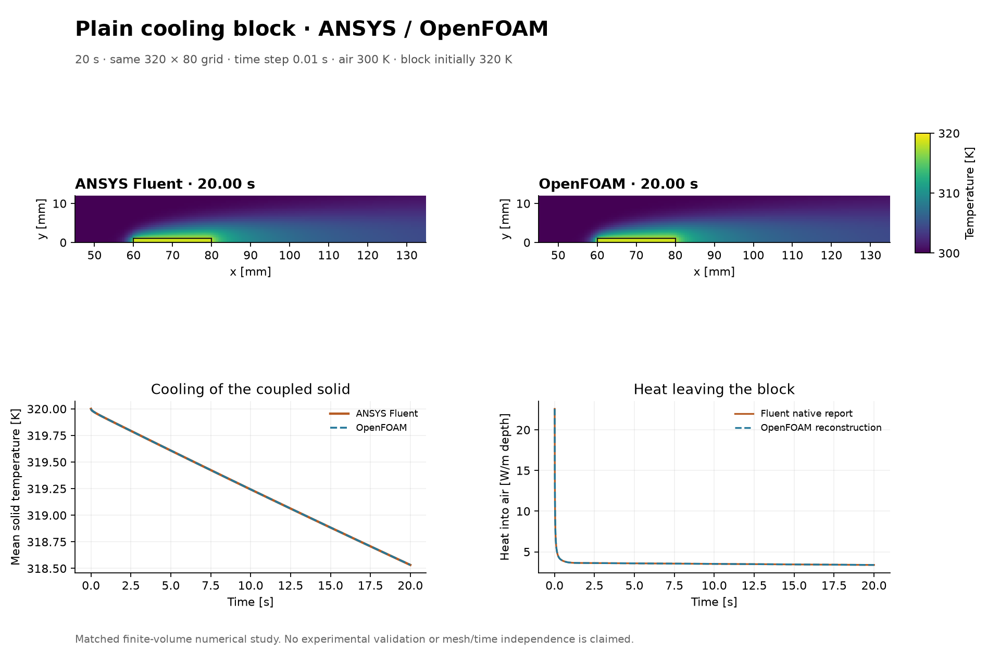
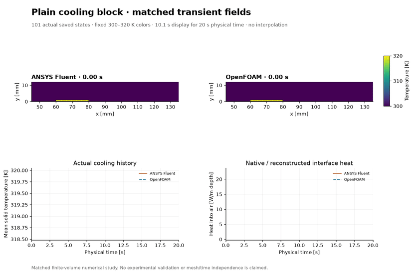

# Plain cooling block in Fluent and OpenFOAM

A 320 K aluminium block cools in a 300 K air stream over 20 s. Both solvers passed the declared numerical checks for all 2,000 steps. The final volume-weighted mean solid temperature was **318.53256 K in Fluent** and **318.53306 K in OpenFOAM**, a difference of about 0.00050 K. The largest cellwise temperature difference over the 101 matched output times was 0.05528 K.

[Download MP4](cooling-block-plain-comparison.mp4) · [Open GIF](cooling-block-plain-comparison.gif) · [Download all-step cooling data](cooling-heat-allstep.csv) · [Numerical evidence and source hashes](comparison-evidence.json)

The video uses saved solver states every 0.2 s from 0 to 20 s, with a fixed 300–320 K color scale and no interpolation. All 101 frames in each encoding were decoded and checked. Playback is 10.1 s at 10 fps.

## Comparison figures

| Figure | PNG | PDF |
| --- | --- | --- |
| Temperature and solid cooling | [PNG](figures/paired-temperature-and-cooling.png) | [PDF](figures/paired-temperature-and-cooling.pdf) |
| Velocity and pressure at 20 s | [PNG](figures/paired-velocity-and-pressure.png) | [PDF](figures/paired-velocity-and-pressure.pdf) |
| Cooling and channel pressure difference | [PNG](figures/paired-cooling-and-pressure-cost.png) | [PDF](figures/paired-cooling-and-pressure-cost.pdf) |
| Residuals and mass conservation | [PNG](figures/paired-numerical-checks.png) | [PDF](figures/paired-numerical-checks.pdf) |
| Regional energy balances | [PNG](figures/paired-regional-energy.png) | [PDF](figures/paired-regional-energy.pdf) |
| Cumulative energy checks | [PNG](figures/paired-prefix-energy-checks.png) | [PDF](figures/paired-prefix-energy-checks.pdf) |

At 20 s, the block had lost 7.337% of its initial sensible energy above 300 K in Fluent and 7.335% in OpenFOAM. Heat transfer into the air at that instant was 3.3870 W/m in Fluent and 3.3859 W/m in OpenFOAM.

## Model and numerical methods

The planar channel measures 160 × 40 mm. A 20 × 1 mm block sits on the floor from x = 60 to 80 mm. The common 320 × 80 grid has 25,520 fluid cells and 80 solid cells. Air starts at 300 K and 0.1 m/s with zero gauge pressure. The inlet supplies the same temperature and speed, the outlet is held at zero gauge pressure with 300 K backflow, and the stationary channel walls are no-slip and adiabatic. The block base is adiabatic, and the exposed faces exchange heat with the fluid. Heat and energy are reported per metre of depth using Fluent's unit depth and OpenFOAM's 1 mm extrusion with empty front and back patches.

| Material | Density (kg/m³) | Specific heat (J/kg·K) | Conductivity (W/m·K) | Dynamic viscosity (Pa·s) |
| --- | ---: | ---: | ---: | ---: |
| Air | 1.225 | 1006 | 0.0262 | 1.7894 × 10⁻⁵ |
| Aluminium | 2700 | 900 | 205 | — |

Both solvers advance laminar flow and conjugate heat transfer together at fixed Δt = 0.01 s with first-order implicit Euler time discretization. The materials have constant properties. The model omits buoyancy, radiation and contact resistance. The solid starts at 320 K and cools by conduction and heat exchange with the air.

Fluent 2026 R1 uses the Coupled pressure–velocity scheme with least-squares gradients, second-order pressure and momentum discretization, first-order upwind energy, and up to 120 inner iterations per step. OpenFOAM Foundation 14 uses the fluid and solid modules of foamMultiRun, with Gauss linear gradients, linear-upwind momentum, upwind fluid enthalpy, orthogonal diffusion, 16 outer iterations and two pressure correctors.

Each solver continued from its accepted 20-step checkpoint at 0.2 s for another 1,980 steps. The combined histories contain 2,001 unique states including the initial condition. After a Windows reboot interrupted OpenFOAM post-processing, the missing fields were reconstructed from the saved partitions with the same native utility. The solver trajectory was reused.

## What the checks establish

- Both native residual checks and the relative boundary mass imbalance limit of 10⁻⁶ passed. Fluent's scaled residuals and OpenFOAM's final-outer residuals use their respective native definitions.
- The fluid, solid, global and interface energy checks met the 0.005 normalized mismatch limit at every step and cumulative prefix. The right-endpoint Euler ledger uses independently measured boundary fluxes and stored thermal plus kinetic energy. Internal interface heat cancels from the global external input.
- Fluent heat uses integrated native face data checked against native reports and shifted to a 300 K sensible-enthalpy datum. OpenFOAM heat is reconstructed from native fields and the upwind and orthogonal discrete operators. Fluent's native enthalpy includes pressure departure and kinetic energy. OpenFOAM stores static enthalpy and kinetic energy separately. The storage calculation removes the incompressible pressure contribution consistently.
- The plotted pressure difference uses mean native fluid-cell pressures in the first and last grid columns. It includes developing channel flow.
- These results provide numerical evidence for this fixed 2D setup. Experimental validation and mesh, time-step and domain independence remain unestablished. The study covers the plain block.

The owner requested and scoped the comparison. Codex prepared the setup, ran the solver workflows and checks, and produced the figures, video and publication record. Fluent and OpenFOAM computed the fields.
