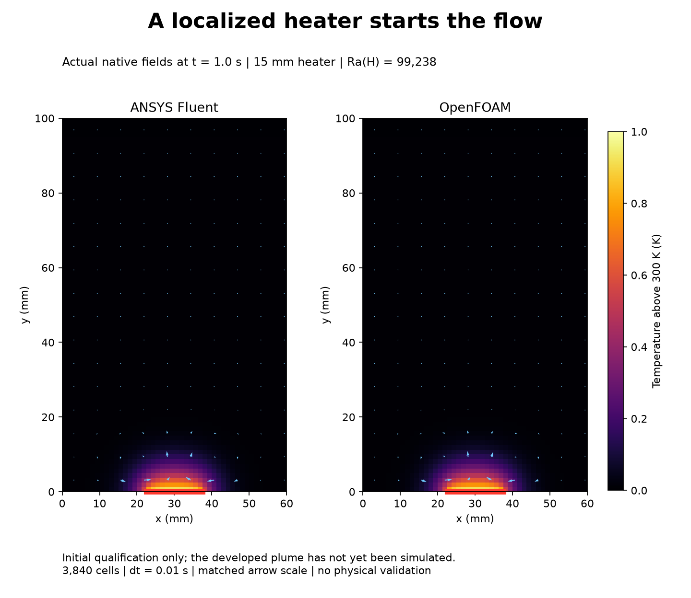

# Localized floor-heater plume: startup qualification

Both ANSYS Fluent and OpenFOAM completed the first **1.0 physical second** on a shared **3,840-cell mesh**. All 100 steps pass their stated numerical criteria. Heating begins above the floor patch. The developed plume and the planned longer animation have not yet been simulated.

## Startup animation

[View the paired temperature and velocity animation](startup-motion-v001/README.md), with fixed scales, native-time checks and convergence plots. This covers only the accepted first second. A separate 20-second extension uses a tighter Fluent continuity criterion and remains in progress.

## Conditions

The closed cavity is 60 mm wide and 100 mm tall, with 48 x 80 uniform square cells. A centered 15 mm floor patch (12 boundary faces, x = 22.5..37.5 mm) is held at 301 K after a quiet gravity control at 300 K. The ceiling remains 300 K. Both side walls and the remaining floor are adiabatic. All walls are stationary and no slip. Fluent is planar 2D; OpenFOAM uses a single 5 mm extrusion with empty front/back patches. Heat and mass are compared per unit depth.

The fluid is laminar ideal-gas air with R = 287.0028467801174 J/(kg K), cp = 1005 J/(kg K), viscosity 1.8e-5 Pa s, conductivity 0.0254788732394 W/(m K), Pr = 0.71 and downward gravity 9.81 m/s². The nominal Rayleigh number based on cavity height and the 1 K wall difference is 99,238. This is not strict Boussinesq flow and not a smoke simulation. Operating reference pressure is 101325 Pa. The actual hydrostatic control fields and their measured masses define each heating run's initial state.

The energy formulation follows [model 30](../../lessons/30-natural-convection/README.md): explicit Fluent rho g dot U, native OpenFOAM gravitational work, pressure work and kinetic energy enabled, viscous work omitted. Both use first-order implicit time advancement with dt = 0.01 s and second-order spatial convection. Each solver uses two processes, sequentially and in the background.

## Numerical evidence

Both quiet controls meet Umax <=1e-5 m/s, temperature deviation <=1e-4 K, mass drift <=1e-5 and ideal-gas consistency <=1e-6. Fluent's quiet-control maximum speed is 1.36e-6 m/s; OpenFOAM's is 1.16e-6 m/s. Their control mass changes are 5.63e-6 and 3.26e-14 respectively. Subsequent heating mass drift is measured from each saved control state, not from the earlier uniform initialization.

The accepted Fluent run uses PISO with neighbor correction, pressure and momentum relaxation 1.0, and at most 800 inner iterations. All 100 steps meet scaled residual limits of 1e-6 for continuity/momentum and 1e-9 for energy. OpenFOAM uses 16 PIMPLE outer correctors and two pressure correctors; all 100 final outer corrections meet initial-residual limits of 1e-6 for velocity/pressure and 1e-8 for enthalpy. These native residual definitions differ.

All saved fields are finite, remain within the declared temperature bounds and satisfy the ideal-gas check. Heating mass drift is at most **5.97e-6 in Fluent** and **1.25e-13 in OpenFOAM**. Fluent minimum orthogonal quality is 1.0; OpenFOAM passes checkMesh. Native vertex geometry maps bijectively to the shared rectangular grid, and the converted heater has exactly 12 faces.

At 1 s, the maximum temperature difference between solvers is **0.000594 K** and the velocity-field L2 difference relative to Fluent is **0.937%**. These are comparisons, not benchmark validation. Pressure coupling still needs attention before a long sealed-gas heating calculation; small residuals alone do not guarantee adequate cumulative mass conservation.

## Preserved attempts

The first Fluent run stopped after step 1 missed its residual targets with a 200-inner cap. Increasing only the cap to 800 still missed y-momentum limits at steps 4, 5 and 9. Those native cases, console checks and executed drivers are retained. The accepted third run changes pressure/momentum relaxation from 0.3/0.7 to 1.0/1.0, following [ANSYS guidance for transient PISO with neighbor correction](https://ansyshelp.ansys.com/public/views/secured/corp/v252/en/flu_ug/flu_ug_sec_uns_solve_pvel_1.html). No acceptance threshold was loosened.

An additional floating-operating-pressure diagnostic is separate from these accepted results. Enabling its flag after loading the saved initialized case left the recorded operating pressure at 101325 Pa and did not demonstrate the expected efficiency benefit. It was saved and stopped at 0.07 s. It is not an accepted production method. Further diagnosis is local work in progress; the setting's name or enabled flag is not evidence that its intended update occurred.

## Reproduction and provenance

Accepted native paths under E:/CFD-Learning-Lab/native/runs/hot-patch-plume-qualification-v001 are fluent-v003 and openfoam. Quiet controls are fluent/isothermal-control and openfoam-control/600. Shared geometry is native/meshes/hot-patch-plume-48x80-v001. Large native files remain outside the repository.

Executed helpers are in code, small actual OpenFOAM dictionaries in openfoam-inputs, and native hashes in qualification-audit.json. Helpers retain workstation paths and require fresh versioned output directories. Dot-source E:/CFD-Learning-Lab/local/Use-Project.ps1 and use the existing Python environment with repo/scripts, local/natural-convection-cavity-v001 and local/hot-patch-plume-v001 on PYTHONPATH. Run one Fluent session at a time; check free disk/RAM and licence admission. The accepted Fluent restart uses the first run's unchanged heated-start case/data at t = 0, not its failed heated state.

The owner chose the visual CFD direction and authorized continuation. Codex prepared, executed, checked and documented the runs. ANSYS Fluent and OpenFOAM computed their respective fields. No owner reflection or independent execution is invented. This is an educational startup qualification: no developed plume, physical validation, mesh/time-step independence or aircraft validation is claimed. This record is local; no new GitHub upload is claimed.

## Follow-up

The separate [20-second calculation](../../lessons/32-heater-plume/README.md) is now recorded. The one-second evidence and historical statements above remain preserved.
